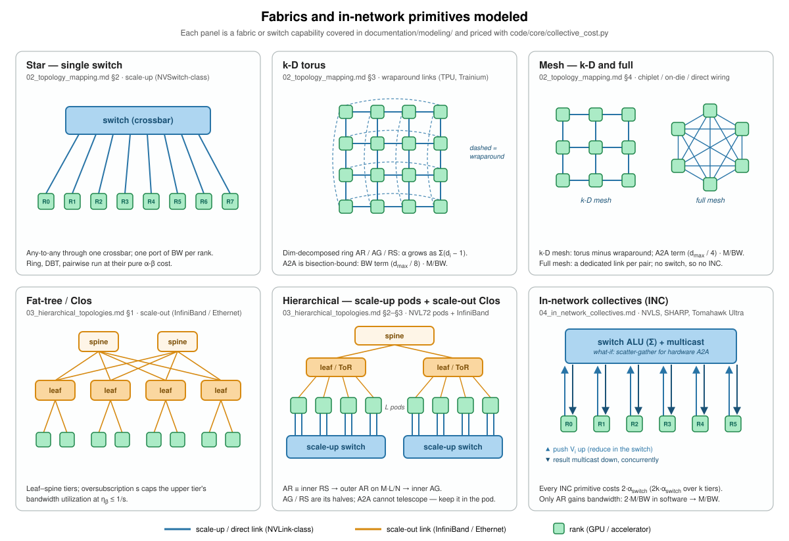

# collective_comm

A first-principles framework for analyzing **collective-communication trade-offs** in distributed AI clusters: α-β cost models, topology-aware algorithms, in-network collectives, and contention coefficients. Designed as a **tutorial + cost-analysis toolkit** — not a runtime library.

If you've ever wondered:
- *Why does NCCL pick DBT for small messages but ring for large ones?*
- *What does NVLS / SHARP actually buy you over a software all-reduce?*
- *How should I split TP/EP/PP/DP across NVL72 vs InfiniBand tiers?*
- *How much performance does fat-tree oversubscription cost in practice?*

…this repo gives you the equations, calibrations, and runnable notebooks to answer them.

**📖 Read the tutorial online:** <https://spicemonkey.github.io/collective-comm/>

---

## What's modeled



**Fabrics**

| Fabric | Real-world examples | Spec | Cost functions |
|---|---|---|---|
| Star (single switch) | NVSwitch / NVL72 scale-up | `02_topology_mapping.md` §2 | `ring_broadcast`, `ring_reduce`, `ring_all_reduce`, `ring_all_gather`, `ring_reduce_scatter`, `tree_*`, `rabenseifner_all_reduce`, `recursive_doubling_all_gather`, `recursive_halving_reduce_scatter`, `pat_*`, `pairwise_a2a`, `bruck_a2a`, `p2p_hop` |
| k-D torus | Google TPU, AWS Trainium | `02_topology_mapping.md` §3 | `torus_all_reduce`, `torus_all_gather`, `torus_reduce_scatter`, `torus_broadcast`, `torus_reduce`, `torus_a2a` |
| k-D mesh (no wraparound) | on-die and chiplet meshes | `02_topology_mapping.md` §4.2 | `torus_all_reduce` / `torus_all_gather` / `torus_reduce_scatter` unchanged; `torus_a2a`, `torus_broadcast`, `torus_reduce` with `wraparound=False` |
| Full mesh | chiplet interposers, direct wiring | `02_topology_mapping.md` §4.1 | the star functions with α → α_link |
| Bidirectional ring | pure-ring wiring (a 1-D torus) | `01_collective_algorithms.md` §7.1 | `ring_relay_a2a` |
| Fat-tree / Clos | InfiniBand and Ethernet scale-out | `03_hierarchical_topologies.md` §1, App. B | per-tier (α, BW); oversubscription through `apply_eta` |
| Hierarchical: scale-up pods + scale-out Clos | NVL72 + InfiniBand SuperPOD, with pod-local or rail-optimized ToRs (the overview draws pod-local) | `03_hierarchical_topologies.md` §2–§3, App. A | `hierarchical_all_reduce*`, `hierarchical_all_gather*`, `hierarchical_reduce_scatter*` |

**In-network collectives** (every primitive costs `2·α_switch` on one switch, `2k·α_switch` across `k` tiers)

| Switch capability | Collectives it accelerates | Hardware | Bandwidth effect | Cost functions |
|---|---|---|---|---|
| In-network reduction (switch ALU) | Reduce, RS | NVLS, Quantum SHARP | none — α only | `inc_reduce`, `inc_reduce_scatter` |
| Switch multicast | BC, AG | NVLS, Quantum SHARP, Tomahawk Ultra | none — α only | `inc_broadcast`, `inc_all_gather` |
| ALU + multicast, fused | AR | NVLS, Quantum SHARP, Tomahawk Ultra | `2·M/BW` → `M/BW` | `inc_all_reduce` |
| Crossbar scatter-gather (hardware A2A) | A2A | none documented — a what-if primitive | none — α only | `inc_a2a` |

**Algorithms per collective**

| Collective | Software algorithms | Topology-specific | In-network |
|---|---|---|---|
| Broadcast / Reduce | ring (chain), binomial tree, pipelined two-tree | torus / mesh dim-decomposed | multicast / ALU |
| All-reduce | ring, double binary tree, Rabenseifner | torus dim-decomposed ring; hierarchical RS → AR → AG | ALU + multicast |
| All-gather / Reduce-scatter | ring, recursive doubling / halving, PAT | torus dim-decomposed ring; hierarchical halves of AR | multicast / ALU |
| All-to-all | pairwise direct-send, ring relay, Bruck | torus / mesh bisection-bound | hardware A2A |

**Contention** — every cost above can be re-scored with per-fabric coefficients `η_α ≥ 1`, `η_β ∈ (0, 1]`: `realistic_cost` for the single-tier functions, `apply_eta` on each tier's (α, BW) for the hierarchical ones (profiles in `util.ETA_PROFILES`; `05_contention_and_congestion.md` §4).

More detailed diagrams: [scale-up + scale-out paths for one server](documentation/modeling/assets/scale_up_scale_out.svg) and [rail-optimized scale-out](documentation/modeling/assets/rail_optimized_scale_out.svg).

---

## Layout

```
collective-comm/
├── documentation/modeling/   ← the spec — every cost formula derives here
│   ├── 00_summary.md         ← entry point / cheatsheet
│   ├── 01_collective_algorithms.md
│   ├── 02_topology_mapping.md
│   ├── 03_hierarchical_topologies.md
│   ├── 04_in_network_collectives.md
│   ├── 05_contention_and_congestion.md
│   ├── references.md
│   └── assets/               ← figures (SVG diagrams, charts/, social card)
└── code/
    ├── core/collective_cost.py   ← α-β cost primitives (BC, Reduce, AR, AG/RS, A2A)
    ├── tests/                    ← stdlib unittest regression suite (canonical anchors)
    ├── util/                     ← anchors, primitive registry, sweep helpers, chart style
    └── notebooks/
        ├── 00_api_enumeration.ipynb           ← every primitive at the canonical anchor
        ├── 01_payload_sweep.ipynb             ← M from 1 KB → 1 GB; α/BW regime crossover
        ├── 02_group_topology_sweep.ipynb      ← G scaling; torus dimensionality
        ├── 03_eta_sensitivity.ipynb           ← realistic η contention; fat-tree oversub
        ├── 04_hierarchical_partitioning.ipynb ← two-tier composition; NVL72 + IB sweep
        └── export_figures.py                  ← re-exports the notebook charts used in the docs
```

---

## Modeling docs (the source of truth)

The series under `documentation/modeling/` is the contract the code implements. Read it before editing any cost function — start with `documentation/modeling/00_summary.md` for the cheatsheet view.

| Doc | Covers |
|---|---|
| `01_collective_algorithms.md` | α-β model; ring / DBT / Rabenseifner / PAT / Bruck per primitive |
| `02_topology_mapping.md` | Single-tier specializations: star, k-D torus, k-D mesh |
| `03_hierarchical_topologies.md` | Multi-tier Clos / fat-tree; hierarchical composition (RS → sub-AR → AG); INC and η per tier |
| `04_in_network_collectives.md` | NVLS / SHARP / Tomahawk Ultra; switch-ALU + multicast |
| `05_contention_and_congestion.md` | η_α, η_β coefficients; calibration profiles |
| `references.md` | Verified equations and primary sources |

---

## Quick start

```bash
# One-time setup (Python 3.14)
python3.14 -m venv .venv
.venv/bin/pip install jupyterlab pandas matplotlib ipykernel

# Open the tutorial notebooks
.venv/bin/jupyter lab code/notebooks/
```

The core cost functions are stdlib-only — you only need pandas / matplotlib for the notebooks.

The examples below import `core` and `util`, so run them from `code/` (or with `PYTHONPATH=code`). To check the canonical anchors:

```bash
.venv/bin/python -m unittest discover -s code/tests
```

---

## Examples

### 1. Compare AR algorithms at the canonical anchor

```python
from core.collective_cost import (
    ring_all_reduce, tree_all_reduce, rabenseifner_all_reduce,
    inc_all_reduce, torus_all_reduce,
)

# N=512 ranks, 16 MB AR payload, NVLink-class fabric
M, G, alpha, bw = 16e6, 512, 0.5e-6, 900e9

print(f"ring AR:           {ring_all_reduce(M, G, alpha, bw) * 1e6:7.1f} μs")  # 546.5
print(f"DBT AR:            {tree_all_reduce(M, G, alpha, bw) * 1e6:7.1f} μs")  # 329.0
print(f"DBT AR pipelined:  {tree_all_reduce(M, G, alpha, bw, pipelined=True) * 1e6:7.1f} μs")  # 44.6
print(f"Rabenseifner AR:   {rabenseifner_all_reduce(M, G, alpha, bw) * 1e6:7.1f} μs")  # 44.5
print(f"INC AR (NVLS):     {inc_all_reduce(M, alpha, bw) * 1e6:7.1f} μs")      # 18.8
print(f"torus 8³ AR:       {torus_all_reduce(M, (8,8,8), alpha, bw) * 1e6:7.1f} μs")  # 56.5
```

### 2. Apply realistic η contention

```python
from core.collective_cost import inc_all_reduce, apply_eta

# NVLS calibration from 05_contention_and_congestion.md §4.1
# (reuses M, alpha, bw from example 1)
alpha_eff, bw_eff = apply_eta(alpha, bw, eta_alpha=1.00, eta_beta=0.52)
print(f"INC AR (realistic): {inc_all_reduce(M, alpha_eff, bw_eff) * 1e6:.1f} μs")  # ~35
```

### 3. Hierarchical AR for an NVL72 + IB cluster

For 288 GPUs split as **4 racks × 72 GPUs/rack** (`L=4`, inner = NVLink, outer = IB; four NVL72s can share one leaf switch per rail):

```python
from core.collective_cost import hierarchical_all_reduce_ring_ring

t = hierarchical_all_reduce_ring_ring(
    M=16e6, N=288, L=4,                  # 4 outer groups, 72 inner each
    alpha_inner=0.5e-6, bw_inner=900e9,  # NVLink-class
    alpha_outer=2.0e-6, bw_outer=100e9,  # 800 Gb/s XDR InfiniBand, same-leaf path
)
print(f"hierarchical AR: {t * 1e6:.1f} μs")  # 121.4
```

The outer sub-AR ships only the *telescoped* payload `M·L/N` — see `documentation/modeling/03_hierarchical_topologies.md` §2.1 for the derivation.

### 4. Enumerate every primitive with the registry

```python
from util import Anchors, run_all

a = Anchors()  # canonical N=512 anchor
for row in run_all(a):
    print(f"{row['name']:42s} {row['t_us']:9.2f} μs")
```

Each `Anchors()` field (M, G, alpha, bw, dims, L, alpha_inner, bw_inner, ...) is overridable; pass the modified anchor back into `run_all` to re-evaluate every primitive.

---

## Canonical regression anchors

The notebooks reproduce these exactly — useful as test oracles when changing cost code:

**Ideal (`documentation/modeling/04_in_network_collectives.md` §3.1)** — N=512, M=16 MB, α=0.5 μs, BW=900 GB/s:

| Algorithm | Cost |
|---|---|
| star + ring AR | 546 μs |
| star + DBT (pipelined, n_β=2) | 45 μs |
| 512-port star + NVLS (INC) | 18.8 μs |
| torus 8³ + dim-decomp ring | 56.5 μs |

**Realistic η (`documentation/modeling/05_contention_and_congestion.md` §5.1)**, same anchor under the §4.1 calibration:

| Algorithm | Profile | Cost |
|---|---|---|
| star + NVLS (INC) | nvls (η_α=1.00, η_β=0.52) | 35 μs |
| star + DBT (pipelined) | crossbar (η_α=1.00, η_β=0.80) | 53 μs |
| torus 8³ + dim-decomp | torus (η_α=1.20, η_β=0.60) | 84 μs |

---

## Project conventions

- **Docs are the source of truth.** When a formula in the docs has a "practice caveat," the code still implements the pure α-β formula — caveats belong in docstrings, not numerical results.
- **Core stays stdlib-only.** Notebooks may import pandas / matplotlib.
- **η profiles are per-fabric calibrations**, not free dials. `nvls` only applies to INC AR; `torus` only to torus algorithms; `crossbar` to software AR on NVSwitch. See `documentation/modeling/05_contention_and_congestion.md` §4.1.
- **Pipelined vs non-pipelined** is exposed as a `pipelined: bool = False` flag on BC / Reduce / DBT AR. Default = literal P=1 schedule; `pipelined=True` = the asymptotic P→P\* limit (Appendix C of `documentation/modeling/01_collective_algorithms.md`).
- **`BW` is the per-rank port bandwidth.** On a single-port star, DBT AR moves 2M through each rank's port, so `tree_all_reduce(..., pipelined=True)` costs `2⌈log₂ N⌉·α + 2·M/BW` (the 45 μs anchor). Pass `multi_port=True` for fabrics where every tree edge has its own full-BW link (up to four per rank); both DBT BW coefficients then halve.

