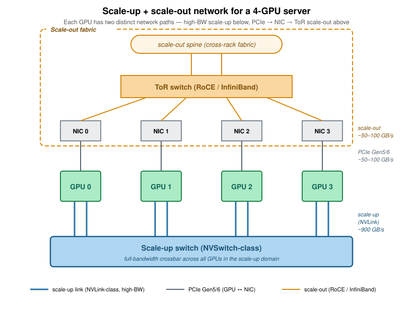
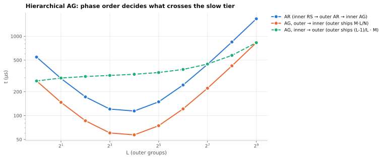
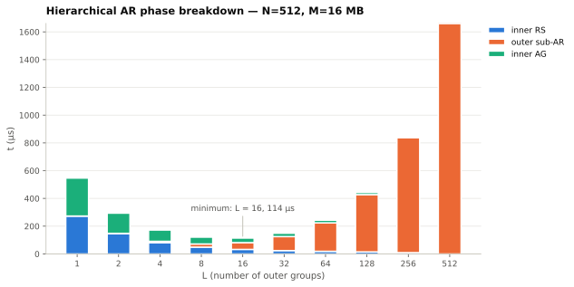
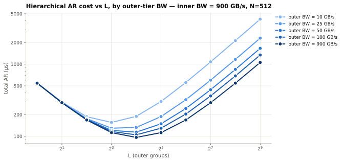
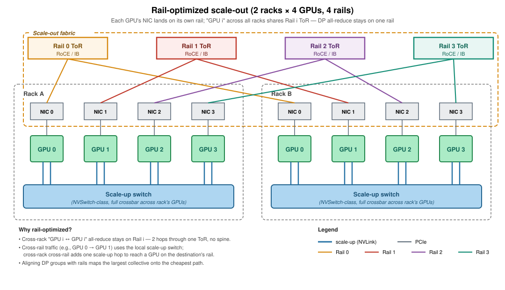

# Hierarchical Topologies: Clos Fabrics, Composition, and In-Network Collectives

**Author:** Yue Lu  
**Date:** April 2026  

Single-tier fabrics hit hard scaling ceilings — NVSwitch radix, torus dimension wiring cost, chiplet pin count — and once a deployment needs more ranks than any one tier can support, hierarchical composition is inevitable. Real clusters layer tiers accordingly: an NVL72 pod is a **star** of 72 GPUs; pods connect through an **InfiniBand Clos**; chiplets inside each GPU package form a **mesh** on the base die. This note covers the canonical multi-tier fabric (§1 Clos architecture), what changes when topologies compose across tiers (§2 composition rules), and how in-network collectives and contention coefficients interact with hierarchical schedules (§3).

# Table of Contents

1. [Multi-tier Clos architecture](#1-multi-tier-clos-architecture)
   - 1.1 [Case study: NVIDIA NVL72 SuperPOD](#11-case-study-nvidia-nvl72-superpod)
   - 1.2 [Cost-model symbols anchored on this SuperPOD](#12-cost-model-symbols-anchored-on-this-superpod)
2. [Composition rules for hierarchical collectives](#2-composition-rules-for-hierarchical-collectives)
   - 2.1 [The RS → sub-AR → AG pattern](#21-the-rs--sub-ar--ag-pattern)
   - 2.2 [A2A on hierarchies — the outlier](#22-a2a-on-hierarchies--the-outlier)
   - 2.3 [When hierarchical helps, when it hurts](#23-when-hierarchical-helps-when-it-hurts)
3. [INC and contention in hierarchies](#3-inc-and-contention-in-hierarchies)
   - 3.1 [SHARP composes at any tier of the hierarchy](#31-sharp-composes-at-any-tier-of-the-hierarchy)
   - 3.2 [Per-tier η in a hierarchical schedule](#32-per-tier-η-in-a-hierarchical-schedule)
   - 3.3 [Pareto implications](#33-pareto-implications)
4. [Appendix A: Worked rail-optimized NVL72 SuperPOD topology (L = 32)](#appendix-a-worked-rail-optimized-nvl72-superpod-topology-l--32)
5. [Appendix B: The k-ary fat-tree](#appendix-b-the-k-ary-fat-tree)
6. [Further reading](#further-reading)

---

## 1. Multi-tier Clos architecture

Each single-layer topology from `02_topology_mapping.md` has a hard scaling ceiling:

- **Star** caps at switch radix (NVSwitch Gen4: 72 ports).
- **Torus** caps at dimensional-wiring cost (TPU v4: $16^3 = 4096$ chips per pod).
- **Full mesh** caps at $O(N^2)$ wire count (~8–16 endpoints).

Beyond each ceiling, the only scaling path is to **compose topologies across tiers** — one topology inner, a different one outer. Modern production stacks are always multi-tier: NVL72 (star) inside InfiniBand (Clos); chiplets (mesh) inside a GPU inside NVLink (star) inside InfiniBand (Clos); TPU chips (torus) inside an ICI slice (torus) inside an inter-slice link. The canonical multi-tier switched construction is the **Clos**: endpoints attach to **leaf switches**, leaves uplink to **spine switches**, and optionally a **super-spine** tier closes a 3-tier Clos. Its cost behavior is controlled by per-tier α-β pairs and an oversubscription ratio that caps upper-tier bandwidth.

**Per-tier characterization.** Each tier is described by four parameters: domain size $N_i$, per-hop latency $\alpha_i$, per-link BW $\mathrm{BW}\_i$, and (for Clos tiers) oversubscription $s_i \geq 1$. The cost of any collective over the full $N = \prod_i N_i$ ranks is a composition of per-tier primitive costs — §2 derives the composition rules; this section anchors them on the Clos topology itself.

**Leaf-spine structure.** $N$ endpoints split across $L$ leaf switches ($N/L$ per leaf). Each leaf switch has two port populations:

- **Downlink ports** face endpoints below — $p_{\mathrm{down}} = N/L$ ports per leaf, each at port-BW.
- **Uplink ports** face the spine tier above — $p_{\mathrm{up}}$ ports per leaf, each at the same port-BW (normally all ports on a switch are identical; "downlink" vs "uplink" is a role assignment, not hardware).

A spine tier of $S$ switches carries all inter-leaf traffic; multiple spines provide multi-path routing and aggregate cross-leaf bandwidth. A small concrete instance:

```
Two-tier Clos (N = 16 endpoints; L = 4 leaves × S = 2 spines; s = 2):

                         ┌──────┐           ┌──────┐
   spine tier:           │  S0  │           │  S1  │              each spine: 4 downlinks
                         └──────┘           └──────┘                (one per leaf)

                          full bipartite — 8 leaf-spine links total
                            (every leaf connects to every spine)

                      ┌────┐    ┌────┐    ┌────┐    ┌────┐
   leaf tier:         │ L0 │    │ L1 │    │ L2 │    │ L3 │         each leaf:
                      └────┘    └────┘    └────┘    └────┘           2 uplinks (→ S0, S1)
                       ▼▼▼▼      ▼▼▼▼      ▼▼▼▼      ▼▼▼▼            4 downlinks
                       R0-3      R4-7      R8-11     R12-15

   Wiring:
     every L_i has 2 uplinks — one to S0, one to S1.
     every S_j has 4 downlinks — one to each of L0 … L3.

   Port-budget: 4 down-port BW per leaf (to endpoints) vs. 2 up-port BW per leaf (to spines)
                → oversubscription s = 4 / 2 = 2 (defined below).
```

**Cost anatomy.** Intra-leaf traffic traverses 2 link hops (endpoint → leaf → endpoint), at α ≈ a single-switch star (~0.5 μs on InfiniBand NDR class). Cross-leaf traffic traverses 4 hops (endpoint → leaf → spine → leaf → endpoint), at roughly 2× the α. (The NVL72 + IB case studies below use end-to-end path values that include NIC serialization — $\alpha_{\mathrm{leaf}} \approx 2\\,\mu$s and $\alpha_{\mathrm{spine}} \approx 8\\,\mu$s, §1.2 — rather than this single-switch figure.) Bandwidth is capped by the minimum of endpoint BW, leaf-uplink aggregate BW, and spine bisection.

**Oversubscription.** The oversubscription ratio at the leaf-to-spine boundary (same notion at any switch tier) is

$$s \\;=\\; \frac{p_{\mathrm{down}}\cdot\mathrm{BW}\_{\mathrm{down}}}{p_{\mathrm{up}}\cdot\mathrm{BW}\_{\mathrm{up}}} \\;\geq\\; 1$$

The special case $s = 1$ ($p_{\mathrm{up}}\cdot\mathrm{BW}\_{\mathrm{up}} = p_{\mathrm{down}}\cdot\mathrm{BW}\_{\mathrm{down}}$) is **full-bisection / non-blocking** — every endpoint can drive its full BW to any other endpoint through the spine without contention. NVIDIA Quantum-class InfiniBand pods are engineered this way by default; Ethernet leaf-spine pods are often full-bisection at the pod level. When full-bisection is too expensive, upper tiers are oversubscribed at $s = 2$, $s = 4$, etc. At $s = 4$ a leaf can receive $4\times$ more traffic from its endpoints than it can push to the spine: under uniform cross-leaf traffic each flow gets only $\mathrm{BW}/s$ northbound. The uplinks are the bottleneck, not the endpoint ports or the spines. The contention-coefficient model in `05_contention_and_congestion.md` captures this directly as $\eta_\beta \approx 1/s$ on upper-tier-crossing traffic — a 4:1 oversubscribed super-spine inflates cross-pod AR's BW term by 4×. **The α term is not inflated by $s$** — oversubscription is a BW knob, not a latency knob. §3.2 below reuses this $\eta_\beta$ hook when scoring hierarchical AR with realistic contention.

**Scaling to three tiers.** When a single spine tier's radix runs out, pods of leaf-spine hierarchies hang under a **super-spine** tier that routes cross-pod traffic. Diameter grows to 6 link hops (endpoint → leaf → spine → super-spine → spine → leaf → endpoint), the per-tier α-β story extends one layer, and each new boundary carries its own $s$:

```
3-tier Clos (schematic):

   [Super-spine]  cross-pod traffic only
        ↑
   [Spine (per pod)]  cross-leaf within pod, plus up to super-spine
        ↑
   [Leaf (per pod)]   endpoints attached
        ↑
   [Endpoints]
```

Production examples: large InfiniBand SuperPOD deployments (thousands of GPUs) and most hyperscaler Ethernet scale-out fabrics. Further layering (4-tier or beyond) is rarely built — once a pod reaches super-spine scale, it's usually cheaper to add pods laterally than another vertical tier.

**Naming: Clos vs fat-tree.** Historically distinct: **Clos** (Charles Clos, 1953) is the general multi-tier switched family, allowing any $s \geq 1$; **Leiserson fat-tree** [LEIS85] is a tree with link bandwidth growing toward the root. The modern datacenter realization — the **k-ary fat-tree** of [AL-FARES08] — is built from commodity $k$-port switches with $k/2$ up / $k/2$ down at every edge and aggregation switch (core switches, at the top, are all-down), yielding a Clos with $s = 1$ at every tier; Appendix B has the port-by-port build. Production AI fabrics (NVIDIA DGX SuperPOD [DGX-SUPERPOD], Meta's Research SuperCluster [META-RSC], hyperscaler Ethernet training pods) follow this structural pattern — tiered Clos with full bipartite at every tier boundary — but don't rigidly hit Al-Fares's exact port accounting: vendors mix switch radices across tiers, and some designs run $s = 1$ at the intra-pod leaf-spine tier while oversubscribing the tier between pods where cost dominates over bandwidth (the two reference designs cited here do not — both are non-blocking throughout). In the rest of this note, **Clos** means the general multi-tier fabric at any $s$, and **fat-tree** is shorthand for the $s = 1$ k-ary variant when the non-blocking property matters — the usage aligns with production InfiniBand / Ethernet vendor literature.

### 1.1 Case study: NVIDIA NVL72 SuperPOD

The NVL72 SuperPOD grounds the abstract Clos above in real hardware and surfaces a common source of reader confusion: **every GPU is attached to *two* physically separate fabrics, so "leaf" and "innermost tier" are both valid terms in this setup but refer to different switches.**

The design followed here is NVIDIA's **DGX SuperPOD with DGX GB300 systems** [DGX-SUPERPOD-GB300]: NVL72 racks on a Quantum-X800 InfiniBand compute fabric at 800 Gb/s (XDR). Its predecessor, the DGX SuperPOD with DGX GB200 [DGX-SUPERPOD-GB200], has the same 72-GPU NVLink rack but a 400 Gb/s (NDR) compute fabric — ConnectX-7 NICs into 64-port Quantum-2 QM9700 switches — so it has half the per-NIC bandwidth, one rack per rail-leaf, and a third switch tier from 2 Scalable Units up. Where a statement below depends on the generation, it says so.

**Two independent fabrics per GPU.** Every GPU in an NVL72 pod has two distinct egress paths:

- **NVLink → NVSwitch (scale-up, intra-pod).** 72 GPUs per NVL72 pod on NVLink Gen5 at 1800 GB/s per GPU (bidirectional aggregate; 900 GB/s per direction). Traffic stays within the pod — NVLink ports do not reach a NIC or ToR.
- **PCIe → ConnectX NIC → IB ToR (scale-out, inter-pod).** Four NICs per 4-GPU compute tray, one per GPU — 72 NICs per NVL72. DGX GB300 trays carry ConnectX-8 at 800 Gb/s (XDR): 100 GB/s per NIC per direction, into Quantum-X800 leaf switches [DGX-SUPERPOD-GB300]. DGX GB200 trays carry ConnectX-7 at 400 Gb/s (NDR): 50 GB/s per NIC, into Quantum-2 QM9700 leaves [DGX-SUPERPOD-GB200]. The leaf switches (called ToRs below, for their position in the Clos) uplink to IB spines.

NCCL routes intra-pod peers over NVLink and cross-pod peers over IB; the two fabrics never share a data path.

```
Two-fabric structure (one NVL72 pod, 72 GPUs):

      ┌──────────────── compute pod ────────────────┐
      │                                             │
      │   ┌───────┐   NVLink   ┌─────────────┐      │
      │   │ GPU_0 │────────────│             │      │    ← scale-up (NVSwitch)
      │   └───┬───┘            │  NVSwitch   │      │      NVLink Gen5: 1800 GB/s bidir.
      │       │ PCIe           │   fabric    │      │      (900 GB/s per direction; 72 GPUs per pod)
      │   ┌───┴───┐            └─────────────┘      │
      │   │ NIC_0 │   (1 NIC per GPU — 72 total)    │
      │   └───┬───┘                                 │
      └───────┼─────────────────────────────────────┘
              │   PCIe Gen5/6  →  ConnectX NIC  →  IB
              ▼
      ┌─────────────┐           ┌─────────────┐
      │  IB ToR     │ ◄───────► │  IB Spine   │          ← scale-out Clos
      │ (Quantum    │           │ (Quantum)   │            (leaf ↔ spine per §1)
      │  "leaf")    │           └─────────────┘            4-hop cross-pod path:
      └─────────────┘                                      NIC → ToR → Spine → ToR → NIC
```



*Figure: the same two-fabric structure at single-tray granularity — NVLink-class scale-up (~900 GB/s per direction) below the GPUs, PCIe → NIC → ToR scale-out (~50–100 GB/s per NIC) above.*

**Mapping to the abstract hierarchy.**

| Abstract tier (used in §2) | NVL72 SuperPOD realization |
|---|---|
| **Innermost** (scale-up) | NVLink Gen5 within the pod, 72 GPUs, 1800 GB/s per GPU bidirectional (900 GB/s per direction) |
| Outer leaf | IB leaf / ToR — Quantum-X800 Q3400 (GB300 design); Quantum-2 QM9700 (GB200 design) |
| Outer spine | IB spine — the same switch model as the leaf in each design |
| Outer super-spine | Only when a deployment outgrows a 2-tier leaf-spine fabric: beyond the 144 leaves (10,368 NICs) that a 144-port Quantum-X800 spine can serve — NVIDIA documents two tiers up to 16 SUs (9,216 GPUs); the GB200 / QM9700 design already adds a core tier at 2 SUs. The $L = 32$, 2304-GPU cluster of Appendix A needs none |

**The common confusion — "leaf" ≠ "innermost tier."** In Clos literature, **leaf** is a position in the switched fabric — the *first* switch an endpoint hits. For NVL72 SuperPODs, that first switch is the IB ToR. But the *innermost tier of the overall hierarchy* is the NVSwitch/NVLink fabric, which sits **below** the NIC in the topology — intra-pod traffic never passes through the NIC or ToR at all. The IB ToR is the entry point of the *outer* tier, not the inside. The gap between the two tiers is large — roughly 9× in per-GPU per-direction BW (900 GB/s NVLink vs 100 GB/s XDR; 18× against a 50 GB/s NDR NIC) and several × in α (NVSwitch cut-through vs cross-pod IB path). §2 picks this up and shows how to compose collectives across tiers so that the fast inner fabric carries most of the work and the slow outer fabric is crossed as little as possible.

**How are 72 NICs actually wired to IB ToRs?** The two-fabric diagram above draws the IB ToR as a single box, which is a deliberate abstraction — the previous paragraphs care only about *which fabric* a packet uses (NVLink vs IB), not about how many ToRs the scale-out fabric has. But in real hardware, an NVL72's 72 NICs fan out to actual switches, and the choice of fan-out pattern determines port-count requirements, failure blast radius, and whether NCCL can exploit rail locality. Two layouts are worth contrasting.

A natural first guess: attach all 72 NICs to one ToR. For full bisection ($s = 1$), that ToR would need 72 downlinks to NICs + 72 uplinks to the spine — exactly **144 ports**. Quantum-X800 Q3400's radix is 144 [QX800], so this math works by construction. Whether this "pod-local" layout is what NVIDIA actually ships is a separate question; it turns out the SuperPOD reference architecture [DGX-SUPERPOD-GB300] uses a different pattern (rail-optimized) that also lands on 144-port ToRs but for a different reason. Both are worth walking through.

**Layout 1 — Pod-local ToR.** All 72 NICs from one NVL72 attach to a single ToR; 72 downlinks to NICs + 72 uplinks to the spine = exactly 144 ports at $s = 1$ full-bisection, matching Quantum-X800 Q3400's radix [QX800] one-for-one.

```
   Pod-local layout (1 ToR per NVL72; all 72 NICs into one X800):

      ┌─────────────── one NVL72 (72 GPUs / 72 NICs) ──────────────┐
      │                                                            │
      │     tray  0:    [N]  [N]  [N]  [N]                         │
      │     tray  1:    [N]  [N]  [N]  [N]                         │
      │       ...                                                  │
      │     tray 17:    [N]  [N]  [N]  [N]                         │
      │                                                            │
      └─────────────────────────────┬──────────────────────────────┘
                                    │  all 72 NICs (one bundle)
                                    ▼
                        ┌─────────────────────────┐
                        │  Quantum-X800 Q3400     │   ← 144 ports:
                        │  (one ToR per NVL72)    │     72 down = 72 NICs
                        └────────────┬────────────┘     72 up  → IB spine
                                     │
                                     ▼
                              ═══ IB spine fabric ═══
```

Simple, but the entire NVL72 shares one failure domain (a single ToR), and no two pods ever share a ToR — every cross-pod path has to climb to the spine.

**Layout 2 — Rail-optimized (NVIDIA SuperPOD reference [DGX-SUPERPOD-GB300]).** NICs at the same *position within a compute tray* across *different* NVL72 pods share one ToR. Each NVL72 compute tray holds 4 GPUs / 4 NICs, so each NIC goes to one of 4 rails. Every NVL72 is striped across 4 rail-ToRs, so any one ToR sees only 18 NICs per pod (one per tray), letting a 144-port X800 aggregate four pods on the same rail: NVIDIA's 8-rack Scalable Unit (SU, 576 GPUs) uses eight leaf switches, two per rail. (Four racks per leaf is read from that document's fabric diagram and port counts — 72 down-ports per leaf, 18 NICs per rack per rail — not from its text.)

```
   Rail-optimized fan-out (NVL72 striped across 4 rail-ToRs):

      ┌─────────────── one NVL72 (72 GPUs / 72 NICs) ──────────────┐
      │                                                            │
      │     tray  0:   [r0]  [r1]  [r2]  [r3]                      │
      │     tray  1:   [r0]  [r1]  [r2]  [r3]                      │
      │       ...                                                  │
      │     tray 17:   [r0]  [r1]  [r2]  [r3]                      │
      │                 │     │     │     │                        │
      └─────────────────┼─────┼─────┼─────┼────────────────────────┘
                        │     │     │     │
                        ▼     ▼     ▼     ▼
                     ┌─────┬─────┬─────┬─────┐
                     │ToR_0│ToR_1│ToR_2│ToR_3│   ← one Quantum-X800 ToR per rail
                     │144p │144p │144p │144p │     (18 NICs from this NVL72 each)
                     └──┬──┴──┬──┴──┬──┴──┬──┘
                        │     │     │     │
                        ▼     ▼     ▼     ▼
                          ═══ IB spine fabric ═══

      Each ToR's 144 ports = 72 NIC downlinks (= 18 × up to 4 NVL72s on this rail
                                                  at s = 1 full-bisection)
                            + 72 spine uplinks.
```

**The inverse view — what one rail-i ToR sees.** The diagram above shows one NVL72 fanning out to 4 rail-ToRs. The flip side is what each rail-ToR collects: it aggregates the rail-i NICs from up to 4 NVL72 pods. Critically, **each pod contributes only 18 NICs to this ToR** (its rail-i slice — one NIC per tray); the pod's other 54 NICs land on the other three rails' ToRs. So one ToR is *not* "consumed" by a single pod — four pods can share it.

```
   Inverse view: one rail-i ToR_Z aggregates rail-i NICs from up to 4 NVL72s

      ┌─NVL72_A─┐  ┌─NVL72_B─┐  ┌─NVL72_C─┐  ┌─NVL72_D─┐
      │ rail-i  │  │ rail-i  │  │ rail-i  │  │ rail-i  │
      │ 18 NICs │  │ 18 NICs │  │ 18 NICs │  │ 18 NICs │
      └────┬────┘  └────┬────┘  └────┬────┘  └────┬────┘
           │            │            │            │
           ▼            ▼            ▼            ▼
      ┌────┴────────────┴────────────┴────────────┴────┐
      │           rail-i ToR_Z (Quantum-X800)          │   ← 144 ports:
      │                                                │     72 down = 4 × 18 NICs
      └───────────────────────┬────────────────────────┘     72 up  → IB spine
                              │
                              ▼
                       ═══ IB spine fabric ═══
```

This is what makes "Same ToR" cross-pod traffic feasible: ToR_Z physically sees 4 pods' rail-i NICs and can bridge any pair of them in 2 hops without involving the spine. Beyond 4 NVL72s on a rail, a second rail-i ToR is needed and cross-ToR-on-rail-i traffic must use the spine (4-hop path).

**Traffic behavior under rail-optimized.** First, the NVLink rule: **intra-pod traffic (GPU_A ↔ GPU_B inside the same NVL72) always uses NVLink** — IB never enters the picture, regardless of rail assignment. The cases below are all *cross-pod*; they must use IB because NVLink does not extend off-pod, and the rail-optimized topology determines how many IB hops are needed.

- **Cross-pod, same rail, same ToR** — NVL72_X and NVL72_Y both attach their rail-i NICs to the same physical ToR_Z: **2 hops** (NIC → ToR_Z → NIC). The IB spine is not needed because one ToR bridges both pods. This applies when up to 4 NVL72s share a rail's ToR (144-port X800 at $s = 1$: 72 down ÷ 18 NICs/pod = 4 pods). The path is read off the wiring — both pods' rail-i NICs are ports of one switch — rather than quoted: the reference architecture's text speaks only of traffic between racks going through the spine layer.
- **Cross-pod, same rail, different ToRs** — once the rail spans more than 4 NVL72s, rail-i NICs spread across rail-i ToR_A and rail-i ToR_B: **4 hops** (NIC → ToR_A → IB spine → ToR_B → NIC). The spine is the only physical path between two same-rail ToRs.
- **Cross-pod, cross-rail** — GPU_i on rail i in pod A ↔ GPU_j on rail j ≠ i in pod B. Two routes exist. (a) *Through the spine*: the spine layer is shared by all four rails (Appendix A.3), so a rail-i ToR reaches a rail-j ToR through any spine — **4 IB hops** (NIC → ToR_i → spine → ToR_j → NIC), even when the two pods sit under the same group of leaves; NVIDIA's reference architecture routes traffic between different rails through the spine layer [DGX-SUPERPOD-GB300]. (b) *NVLink rail bridge*: the source first sends over NVLink to the sibling GPU in its own tray whose NIC is on rail j, and that NIC sends on rail j — 1 NVLink hop + the same-rail IB path, which is **2 IB hops** (NIC → ToR_j → NIC) when pods A and B share a rail-j ToR and 4 when they don't. This is NCCL's PXN feature: a GPU uses a NIC that is not its own by first moving the data over NVLink, so that a message can stay on one rail's leaf switch and avoid the spine tier [NCCL-PXN]. The bridge costs one extra ~0.5 μs NVLink hop on top of the same-rail IB cost for that pod pair.

NCCL's PXN (NCCL 2.12) fits this layout: it moves data over NVLink to a GPU on the same rail as the destination and sends from there without crossing rails, which reduces traffic through the spine tier [NCCL-PXN]. (The blog describes 8-GPU DGX nodes; this note assumes the same mechanism for the four GPUs of an NVL72 compute tray.) A same-rail path needs no bridge hop at all, and for pods sharing a rail-ToR it skips the spine as well (2 IB hops, where the pod-local layout always needs 4). NVIDIA's stated case for rail-optimized fabrics is all-reduce performance with less interference between flows, and a cheaper network through lighter connections between rails [NCCL-PXN]. The price is that a lone pod touches 4 ToRs instead of 1; at SU scale the two layouts need the same number of ToRs (32 at $L = 32$), since each 144-port ToR hosts 72 NICs either way.

**Bottom line on the 144-port ToR usage.** Both layouts use 144-port X800, but sized for different jobs:

- **Pod-local**: 144 = 72 NICs + 72 spine uplinks, one NVL72 exactly ([QX800]).
- **Rail-optimized**: 144 ports aggregates a rail across up to 4 NVL72s — 72 NICs from four pods + 72 spine uplinks ([DGX-SUPERPOD-GB300]).

The X800 radix fits both layouts; the Q3400 is the leaf and spine switch of the DGX GB300 SuperPOD reference architecture [DGX-SUPERPOD-GB300]. (The DGX GB200 reference architecture, on 64-port QM9700 switches, gives each rack its own leaf per rail — 18 NICs down — so no two racks share a rail-ToR there [DGX-SUPERPOD-GB200].)

### 1.2 Cost-model symbols anchored on this SuperPOD

§2's cost formulas and case studies use a small set of symbols. We anchor their meaning and concrete values once here so downstream subsections can plug in numbers without re-introducing notation. The bandwidths come from the hardware described in §1.1; the α values are order-of-magnitude estimates (`references.md`, numerical caveats).

*Latency (α).* Three distinct switch paths surface in production, matching the three traffic classes from §1.1's "Traffic behavior under rail-optimized":

| Symbol | Path | NVL72 + IB value |
|---|---|---|
| $\alpha_{\mathrm{inner}}$ | Intra-pod GPU↔GPU on scale-up (NVSwitch cut-through) | $\approx 0.5\\,\mu$s |
| $\alpha_{\mathrm{leaf}}$ | Cross-pod 2-hop IB path (NIC → shared rail-ToR → NIC) | $\approx 2\\,\mu$s |
| $\alpha_{\mathrm{spine}}$ | Cross-pod 4-hop IB path (NIC → ToR → spine → ToR → NIC), end-to-end including NIC serialization | $\approx 8\\,\mu$s |

$\alpha_{\mathrm{leaf}}$ applies when pods share a rail-ToR — possible only at small scale, since a 144-port X800 at $s = 1$ holds at most 4 NVL72s per rail. $\alpha_{\mathrm{spine}}$ is the general cross-pod cost once the rail spans more than 4 NVL72s.

§2.1's hierarchical-AR formulas use a *derived* symbol $\alpha_{\mathrm{outer}}$ for the cross-pod α — the **effective** cross-pod latency for the deployment, equal to:

- $\alpha_{\mathrm{outer}} = \alpha_{\mathrm{leaf}}$ when all participating pods share a rail-ToR (small scale).
- $\alpha_{\mathrm{outer}} = \alpha_{\mathrm{spine}}$ when pods span multiple rail-ToRs (production scale).
- A weighted average of the two when the schedule has both same-ToR and spine-traversing hops (e.g., a ring AR across 8 pods split 4-and-4 across two rail-ToRs sees 6 same-ToR hops at $\alpha_{\mathrm{leaf}}$ and 2 cross-ToR hops at $\alpha_{\mathrm{spine}}$).

Case studies plug in concrete values: §2.1's $L = 2$ walk-through uses $\alpha_{\mathrm{outer}} = \alpha_{\mathrm{leaf}}$ (small-scale, pods share a rail-ToR); a production-scale $L = 32$ deployment would use $\alpha_{\mathrm{outer}} = \alpha_{\mathrm{spine}}$ instead. §2.2's A2A formula itemizes by destination, so it doesn't use $\alpha_{\mathrm{outer}}$ — all three primitive α values ($\alpha_{\mathrm{inner}}$, $\alpha_{\mathrm{leaf}}$, $\alpha_{\mathrm{spine}}$) appear directly.

*Bandwidth (BW), per GPU per direction.*

| Symbol | Source | NVL72 + IB value |
|---|---|---|
| $\mathrm{BW}\_{\mathrm{inner}}$ | NVLink Gen5 (per direction; 1800 GB/s bidirectional aggregate) | $\approx 900\\,\mathrm{GB/s}$ |
| $\mathrm{BW}\_{\mathrm{outer}}$ | ConnectX-8 at 800 Gb/s XDR [DGX-SUPERPOD-GB300] (a GB200-generation ConnectX-7 at 400 Gb/s NDR gives 50 GB/s [DGX-SUPERPOD-GB200]) | $\approx 100\\,\mathrm{GB/s}$ |

In multi-tier formulas each phase's BW term uses its own tier's BW — inner phases at $\mathrm{BW}\_{\mathrm{inner}}$, outer phases at $\mathrm{BW}\_{\mathrm{outer}}$ (§2.1). The outer tier is 9× slower per byte (18× with NDR NICs), which is why hierarchical schedules shrink the payload before it crosses.

*Shape parameters.* $N$ = total ranks; $L$ = number of pods; $N_{\mathrm{inner}} = N/L$ = GPUs per pod (= 72 on NVL72); $p$ = pods sharing a rail-ToR ($\leq 4$ at $s = 1$).

These symbols carry through §2 unchanged.

---

## 2. Composition rules for hierarchical collectives

**The core idea.** In single-tier, a collective like AR is one algorithm running over one fabric — pick a ring, a DBT, or Rabenseifner, evaluate with that fabric's $(\alpha, \mathrm{BW})$, done. In multi-tier, the same user-level collective often gets re-expressed as a **combination of different primitives running on different tiers**. A hierarchical AR isn't "run AR on tier 1, then AR on tier 2" — it's a sequence like **RS on the inner tier, AR on the outer tier, AG on the inner tier** that composes to the same result. The per-tier primitives need not be the same primitive the user asked for; they're chosen so each tier does the work it's best at, and so the outer tier sees as little data as possible. The idea is old in MPI: MagPIe for clustered wide-area systems [MAGPIE], the hierarchical collectives of MPICH2 [ZGGT09] and Open MPI's HAN framework [HAN] all organize a collective around the machine's hierarchy — one level inside a group, one between groups.

**Why this re-expression is possible (and necessary).** Two reasons.

1. **Tiers are heterogeneous.** An intra-pod hop costs ~0.5 μs at ~900 GB/s on NVSwitch while a cross-pod hop costs 2–8 μs at ~100 GB/s on InfiniBand. A flat schedule that treats the Clos as one big star pays $\log N \cdot \alpha_{\mathrm{spine}}$ on every algorithmic hop and $2(N-1)/N \cdot M/\mathrm{BW}\_{\mathrm{outer}}$ on every byte — wasting the fast intra-pod fabric entirely. Decomposing across tiers lets each tier pay only its own α on its own phase, and lets the outer tier carry a shrunk payload rather than the full $M$.
2. **The collective's algebraic structure allows it.** Reduction is associative — reducing locally first then globally gives the same answer as reducing in one flat pass. Broadcast is replication — copying locally then globally is equivalent to one flat copy. These are the structural hooks that let the single-tier collective be factored into a multi-phase schedule. Each of AR, AG, RS, BC, Reduce has such a factoring; the specific phase pattern differs (§2.1 tabulates all five).

**Two design levers in every hierarchical schedule.** Once you accept that a single-tier collective can be re-expressed as a cross-tier combination, the schedule has two knobs: *which primitive runs on which tier*, and *how much payload crosses each tier boundary*. The canonical AR pattern (RS → sub-AR → AG) uses both: it puts the bulk of the α-hops on the fast inner tier and shrinks the payload from $M$ to $ML/N$ before any byte crosses the slow outer tier. §2.1 develops this pattern for AR and shows how AG, RS, BC, Reduce fall out as halves or trivial cascades of it.

**The exception: A2A.** Not every collective has the algebraic structure to decompose. All-to-all has no associativity or replication hook — every source-destination pair carries a distinct payload, so the cross-tier permutation traffic equals the full $(N-1)/N \cdot M$ bytes regardless of how the schedule is phased. §2.2 works through why A2A doesn't decompose and how its cost formula becomes a destination-weighted sum over distance classes rather than a phased pipeline.

The cost formulas below use the symbols defined in §1.2 — $\alpha_{\mathrm{inner}}$, $\alpha_{\mathrm{leaf}}$, $\alpha_{\mathrm{spine}}$, $\mathrm{BW}\_{\mathrm{inner}}$, $\mathrm{BW}\_{\mathrm{outer}}$, plus the shape parameters $N$, $L$, $N_{\mathrm{inner}}$, $p$. Refer back to that table for concrete NVL72 + IB values when plugging numbers in.

### 2.1 The RS → sub-AR → AG pattern

Hierarchical AR composes the primitives from `01_collective_algorithms.md` across tiers by exploiting reduction's associativity. For a 2-tier hierarchy with $L$ outer groups of $N/L$ inner ranks each, the canonical schedule is:

```
Phase 1 (intra-group RS):   each of L groups runs independent RS across its N/L ranks
                            → each rank now holds (L/N)·M bytes of partially-reduced data
                            → per-group RS runs on the inner tier's fabric at (α_inner, BW_inner)

Phase 2 (cross-group AR):   L ranks-per-rank-position run AR across the outer tier
                            → the M·L/N byte payload now sees the outer tier's (α_outer, BW_outer)
                              (α_outer = α_leaf, α_spine, or a mix — see §1.2)
                            → this AR can itself be another hierarchical AR if k > 2 tiers

Phase 3 (intra-group AG):   each of L groups runs independent AG across its N/L ranks
                            → each rank now holds the fully-reduced M bytes
                            → reverse of phase 1 on the inner tier
```

**Why this composes correctly.** Reduction is associative, so the inner-then-outer order produces the same result as a flat AR across all $N$ ranks. The per-rank chunk size telescopes: after inner RS, each rank holds $M / (N/L) = ML/N$ bytes (not $M$), so the outer AR moves less data. This is the same bandwidth-telescoping argument as torus dim-decomposition (`02_topology_mapping.md §3.1`), generalized across heterogeneous tiers.

**Worked example — N = 4, L = 2.** Four ranks {A, B, C, D}; leaf 0 holds {A, B}, leaf 1 holds {C, D}. Each rank starts with a 4-chunk vector; target is every rank ending with $\Sigma = [\Sigma_0, \Sigma_1, \Sigma_2, \Sigma_3]$ where $\Sigma_k = a_k + b_k + c_k + d_k$ sums all four ranks' chunk-$k$ values.

```
  Initial state              Phase 1: intra-leaf RS       Phase 2: cross-leaf sub-AR
  (each rank full M)         (N/L = 2 ranks per leaf)     (L = 2 ranks per chunk pair)
                             [runs on NVSwitch fabric]    [runs on IB ToR + spine]
                             [intra-pod, fast]            [cross-pod, slow]

  Leaf 0                     Leaf 0                       Leaf 0
    A: [a0,a1,a2,a3]           A: [a0+b0, a1+b1,  · ,  · ]  A: [ Σ0 ,  Σ1 ,  · ,  · ]
    B: [b0,b1,b2,b3]   ──►     B: [ · ,  · , a2+b2,a3+b3]   B: [ · ,  · ,  Σ2 ,  Σ3 ]

  Leaf 1                     Leaf 1                       Leaf 1
    C: [c0,c1,c2,c3]           C: [c0+d0, c1+d1,  · ,  · ]  C: [ Σ0 ,  Σ1 ,  · ,  · ]
    D: [d0,d1,d2,d3]   ──►     D: [ · ,  · , c2+d2,c3+d3]   D: [ · ,  · ,  Σ2 ,  Σ3 ]

  Payload per rank: M        Payload per rank: M·L/N       Sub-AR pairs (one AR per
                             = M/2 (leaf-partial sums      chunk-position group):
                              on 2 chunks)                   {A, C} sum chunks 0, 1
                                                             {B, D} sum chunks 2, 3

  Phase 3: intra-leaf AG (exchange chunks within each leaf)
  [runs on NVSwitch fabric — mirrors Phase 1]

  Leaf 0: A ↔ B exchange         A: [Σ0, Σ1, Σ2, Σ3]
                                 B: [Σ0, Σ1, Σ2, Σ3]
  Leaf 1: C ↔ D exchange         C: [Σ0, Σ1, Σ2, Σ3]
                                 D: [Σ0, Σ1, Σ2, Σ3]

  AR complete: every rank holds the full Σ.
```

**Decoding "sub-AR".** The phase-2 AR runs on a sub-group of $L$ ranks (one per leaf), not on all $N$. There are $N/L$ such sub-groups — one per chunk-position — and they run concurrently. Each sub-AR completes the reduction for its chunk positions across leaves: if A holds the leaf-0 partial of chunks 0–1 and C holds the leaf-1 partial of the same chunks, AR on {A, C} produces the full $N$-way reduction for chunks 0–1. The trick is that RS in phase 1 shrinks the "which chunks each rank owns" set to $L/N$ of the full vector, so the phase-2 AR only needs to operate on that narrow slice — paying $L$-ranks α-cost on an $ML/N$-byte payload instead of $N$-ranks α-cost on $M$ bytes. Phase 3 AG then broadcasts the fully-reduced slices back within each leaf so every rank ends up with all $M$ bytes.

**Cost formula.** Summing the three phases:

$$t_{\mathrm{AR}} \\;=\\; t_{\mathrm{RS,inner}}\\!\left(\tfrac{N}{L}, M\right) \\;+\\; t_{\mathrm{AR,outer}}\\!\left(L, \tfrac{ML}{N}\right) \\;+\\; t_{\mathrm{AG,inner}}\\!\left(\tfrac{N}{L}, M\right)$$

Each term instantiates the primitive cost formulas from `01_collective_algorithms.md` / `02_topology_mapping.md` with the matching tier's $(\alpha, \mathrm{BW})$. For $k > 2$ tiers, the outer AR term is itself hierarchical — recursion down the tree until the innermost tier is reached.

**Inner-tier cost in composed deployments.** When the Clos leaf port attaches a whole scale-up pod (e.g., an NVL72 with 72 GPUs behind one NVSwitch) rather than a single GPU, the "inner tier" in the hierarchical schedule *is* that scale-up fabric: $t_{\mathrm{RS,inner}}$ and $t_{\mathrm{AG,inner}}$ instantiate the star (or torus, or mesh) cost from `02_topology_mapping.md §5.1` at the pod's $(\alpha_{\mathrm{inner}}, \mathrm{BW}\_{\mathrm{inner}})$; the outer AR phase instantiates the Clos AR at $(\alpha_{\mathrm{outer}}, \mathrm{BW}\_{\mathrm{outer}})$, where $\alpha_{\mathrm{outer}}$ resolves to $\alpha_{\mathrm{leaf}}$, $\alpha_{\mathrm{spine}}$, or a mix per the §1.2 catalog. **Intra-pod α-β cost is part of the hierarchical total by construction — not an overhead layered on top.** The same holds for AG, RS, BC, Reduce: each row of the summary table below evaluates its `inner` term at the scale-up fabric's cost.

**The $\alpha$ and BW structure.** For 2-tier with ring-on-ring:

$$t_{\mathrm{AR}}^{\mathrm{2\text{-}tier}} \\;=\\; 2\\!\left(\tfrac{N}{L} - 1\right)\alpha_{\mathrm{inner}} + 2(L-1)\\,\alpha_{\mathrm{outer}} + \frac{2(N-L)}{N}\cdot\frac{M}{\mathrm{BW}\_{\mathrm{inner}}} + \frac{2(L-1)}{N}\cdot\frac{M}{\mathrm{BW}\_{\mathrm{outer}}}$$

Each tier's BW term is priced at its own BW: the inner RS + AG pair moves $2(N/L - 1)/(N/L) = 2(N-L)/N$ of $M$ at $\mathrm{BW}\_{\mathrm{inner}}$, and the outer ring AR moves $2(L-1)/L$ of the telescoped $ML/N$ payload — $2(L-1)/N$ of $M$ — at $\mathrm{BW}\_{\mathrm{outer}}$. With equal BWs the two coefficients sum back to the flat ring's $2(N-1)/N$. In practice $\mathrm{BW}\_{\mathrm{outer}} \ll \mathrm{BW}\_{\mathrm{inner}}$ (IB at 100 GB/s vs NVLink at 900 GB/s, a 9× gap), but telescoping shrinks the outer coefficient by more than that at small $L$ — the BW term stays inner-dominated until $(L-1)\cdot\mathrm{BW}\_{\mathrm{inner}}/\mathrm{BW}\_{\mathrm{outer}}$ becomes comparable to $N - L$ (with 72-GPU pods, $N = 72L$, the outer share never exceeds $9/71 \approx 13\\%$ of the inner term).

**AG, RS, BC, Reduce drop out.** The three-phase pattern above already contains RS and AG as its two halves — AR ≡ inner RS → [outer RS → outer AG] → inner AG, where the bracket is the outer sub-AR. Standalone **RS** is the first half: inner RS → outer RS (phase 1, then the reduce half of phase 2). Standalone **AG** is the second half: outer AG → inner AG (the gather half of phase 2, then phase 3, no reduction). In both, the outer tier touches only the telescoped $ML/N$-byte payload — RS shrinks the data *before* it crosses the slow tier, AG crosses *before* it expands. (The opposite orders — outer RS first, or inner AG first — compute the same result but push $(L-1)/L$ of the full $M$ across the slow tier.) **BC** and **Reduce** cascade trivially across tiers — no reduction to amortize. The full summary:

| Primitive | 2-tier composition | α term | BW term (at $s=1$, uniform BW) |
|---|---|---|---|
| **AR** | inner RS → outer AR → inner AG | $2(N/L - 1)\alpha_{\mathrm{inner}} + 2(L - 1)\alpha_{\mathrm{outer}}$ | $2(N-1)/N \cdot M/\mathrm{BW}$ |
| **AG** | outer AG → inner AG | $(L - 1)\alpha_{\mathrm{outer}} + (N/L - 1)\alpha_{\mathrm{inner}}$ | $(N-1)/N \cdot M/\mathrm{BW}$ |
| **RS** | inner RS → outer RS | $(N/L - 1)\alpha_{\mathrm{inner}} + (L - 1)\alpha_{\mathrm{outer}}$ | $(N-1)/N \cdot M/\mathrm{BW}$ |
| **BC** | outer BC → inner BC | $\lceil\log_2 L\rceil\\,\alpha_{\mathrm{outer}} + \lceil\log_2(N/L)\rceil\\,\alpha_{\mathrm{inner}}$ | $M/\mathrm{BW}$ (pipelined) |
| **Reduce** | inner Reduce → outer Reduce | $\lceil\log_2(N/L)\rceil\\,\alpha_{\mathrm{inner}} + \lceil\log_2 L\rceil\\,\alpha_{\mathrm{outer}}$ | $M/\mathrm{BW}$ (pipelined) |

(Plug in $\alpha_{\mathrm{outer}} = \alpha_{\mathrm{leaf}}$ for small deployments where pods share a rail-ToR, $\alpha_{\mathrm{outer}} = \alpha_{\mathrm{spine}}$ for production deployments spanning multiple rail-ToRs, or a weighted mix when the schedule has both same-ToR and spine-traversing hops; see §1.2.)

With distinct tier BWs the AG / RS BW term splits the same way as AR's, at half the size: $\frac{N-L}{N}\cdot\frac{M}{\mathrm{BW}\_{\mathrm{inner}}} + \frac{L-1}{N}\cdot\frac{M}{\mathrm{BW}\_{\mathrm{outer}}}$. In the argument form of the AR cost formula above (group size, per-rank payload), $t_{\mathrm{AG}} = t_{\mathrm{AG,outer}}(L, \tfrac{ML}{N}) + t_{\mathrm{AG,inner}}(\tfrac{N}{L}, M)$ and $t_{\mathrm{RS}} = t_{\mathrm{RS,inner}}(\tfrac{N}{L}, M) + t_{\mathrm{RS,outer}}(L, \tfrac{ML}{N})$.

For oversubscription $s > 1$ at any tier boundary, multiply the BW term by $s$ on traffic crossing that boundary — equivalent to $\eta_\beta \approx 1/s$ in `05_contention_and_congestion.md` §4.2. AG and RS cost **half of AR** on both α (one pass, not two) and BW (one telescoped pass, not the doubled AR round-trip); BC and Reduce stay at the $M/\mathrm{BW}$ pipelined ceiling regardless of tier count, with α scaling log-depth on each tier.



*Figure: why the order matters ($N = 512$, $M = 16\\,\mathrm{MB}$, inner $0.5\\,\mu$s / $900\\,\mathrm{GB/s}$, outer $2\\,\mu$s / $100\\,\mathrm{GB/s}$ — §1.2's $\alpha_{\mathrm{leaf}}$ and $\mathrm{BW}\_{\mathrm{outer}}$ on the $N = 512$ anchor, not the case study's 72-GPU pods). AG composed outer-first costs exactly half of AR at every $L$; composed inner-first it ships $(L-1)/L \cdot M$ over the slow tier and costs up to $2.9\times$ more. From `code/notebooks/04_hierarchical_partitioning.ipynb`.*

**Case study: NVL72 + IB SuperPOD (AR).** Using the §1.2 symbol values, take a 2-pod deployment ($L = 2$, $N = 144$, $M = 16\\,\mathrm{MB}$, ring-on-ring schedule). At this scale the two pods share a rail-ToR ($p = 2$, well within the $p \leq 4$ budget), so $\alpha_{\mathrm{outer}} = \alpha_{\mathrm{leaf}} \approx 2\\,\mu$s for the outer phase:

- **Inner RS** (ring on 72 GPUs over NVSwitch): $(N_{\mathrm{inner}}-1)\\,\alpha_{\mathrm{inner}} = 71 \cdot 0.5 = \mathbf{35.5\\,\mu s}$ α; $\frac{71}{72}\cdot\frac{M}{\mathrm{BW}\_{\mathrm{inner}}} \approx \mathbf{17.5\\,\mu s}$ BW.
- **Outer sub-AR** (ring on 2 pods through the shared rail-ToR): payload has telescoped to $ML/N = 0.22\\,\mathrm{MB}$; $2(L-1)\\,\alpha_{\mathrm{outer}} = 2 \cdot 1 \cdot 2 = \mathbf{4\\,\mu s}$ α + $\frac{2(L-1)}{L}\cdot\frac{ML/N}{\mathrm{BW}\_{\mathrm{outer}}} \approx \mathbf{2.2\\,\mu s}$ BW.
- **Inner AG**: mirrors inner RS — **35.5 μs α + 17.5 μs BW**.

**Hierarchical total: ≈ 75 μs α + 37.3 μs BW ≈ 112.3 μs.**

How does this compare to two hypothetical flat-ring baselines at the same $N = 144$?

| Schedule (all at $N = 144$, $M = 16\\,\mathrm{MB}$) | α (μs) | BW (μs) | **Total** |
|---|---|---|---|
| Flat ring on a hypothetical 144-GPU NVSwitch domain (NVLink doesn't actually span pods, but assume it could): $2(N-1)\\,\alpha_{\mathrm{inner}} + 2(N-1)/N \cdot M/\mathrm{BW}\_{\mathrm{inner}}$ | 143 | 35 | **~178** |
| **Hierarchical NVLink + IB** (this case study) | **75** | **37.3** | **~112.3** |
| Flat ring forced over IB only (ignore NVLink): $2(N-1)\\,\alpha_{\mathrm{spine}} + 2(N-1)/N \cdot M/\mathrm{BW}\_{\mathrm{outer}}$ | 2,288 | 318 | **~2,610** |

Two takeaways:

1. **Hierarchical beats flat-NVSwitch (112 vs 178 μs) even on the same fast fabric.** The α saving comes from running $L$ parallel inner rings of $N/L$ ranks each ($N/L - 1$ steps) instead of one ring of $N$ ranks ($N - 1$ steps). The α formula goes from $2(N-1)\\,\alpha$ to $2(N/L - 1)\\,\alpha + 2(L - 1)\\,\alpha_{\mathrm{outer}}$ — at $L = 2$ this is $286\alpha \to 144\alpha$ on a uniform-α basis, a ~50% reduction *before* the outer tier even gets involved. The "shorter parallel rings" effect; at the uniform-α optimum $L \approx \sqrt{N}$ the count drops to $4(\sqrt{N} - 1)$, roughly a $\sqrt{N}/2$ speedup on the α term.
2. **Hierarchical beats flat-IB by ~23×, mostly on α** (about nine-tenths of the saving), because 71 of the 75 μs of α work runs on NVSwitch at $\alpha_{\mathrm{inner}} = 0.5\\,\mu$s instead of on IB at $\alpha_{\mathrm{spine}} = 8\\,\mu$s, *and* payload telescoping cuts what crosses the outer tier from $M$ down to $M/72$.

So hierarchical wins on two distinct axes: shorter parallel inner rings (works on any fabric, beats flat-NVSwitch) plus payload telescoping when the outer tier is slower (turns the IB-side BW from 318 μs into 2.2 μs). At production scale ($L = 32$, pods spanning multiple rail-ToRs so $\alpha_{\mathrm{outer}} = \alpha_{\mathrm{spine}}$), the gap to flat baselines widens further, and SHARP on the outer Clos (§3.1) collapses the outer α to $\sim 2k\\,\alpha_{\mathrm{switch}}$ ($k = 2$ switch tiers, leaf + spine).

### 2.2 A2A on hierarchies — the outlier

A2A is the one primitive where hierarchical composition doesn't help. No reduction or replication semantics to exploit across tiers — every source-destination pair carries a distinct payload, and each rank still ships its full $(N-1)/N \cdot M$ bytes of permutation traffic regardless of schedule, $(1 - 1/L) \cdot M$ of it across the tier boundary. The BW bound is the **outermost tier's bisection**; no hierarchical schedule can beat it. If the outer tier is oversubscribed at $s$ or has per-leaf BW below per-endpoint BW, A2A realized BW drops by the full factor. Unlike §2.1, A2A's cost itemizes per destination — each pairwise send pays its destination's *actual* path latency rather than an average — so all three α values from §1.2 ($\alpha_{\mathrm{inner}}$, $\alpha_{\mathrm{leaf}}$, $\alpha_{\mathrm{spine}}$) appear simultaneously in its cost formula.

**Cost formula.** Implementations ship as pairwise direct-send: each rank serializes $N{-}1$ outgoing messages of size $M/N$ through its outbound port. Each send pays its destination's actual path cost ($\alpha + (M/N)/\mathrm{BW}$); the total is a destination-weighted sum. In a real NVL72 + IB SuperPOD, peers split across **three** distance classes (counts shown for $L$ pods total, $p$ pods sharing a rail-ToR, $N_{\mathrm{inner}}$ GPUs per pod):

| Peer count | Destination class | Path α | Path BW |
|---|---|---|---|
| $N_{\mathrm{inner}} - 1$ | Intra-pod (NVSwitch scale-up) | $\alpha_{\mathrm{inner}}$ | $\mathrm{BW}\_{\mathrm{inner}}$ |
| $(p - 1)\\,N_{\mathrm{inner}}$ | Same-leaf cross-pod (through shared rail-ToR) | $\alpha_{\mathrm{leaf}}$ | $\mathrm{BW}\_{\mathrm{outer}}$ |
| $(L - p)\\,N_{\mathrm{inner}}$ | Cross-leaf cross-pod (through IB spine) | $\alpha_{\mathrm{spine}}$ | $\mathrm{BW}\_{\mathrm{outer}}$ |

The α and BW terms separate out as:

$$t_\alpha^{\mathrm{A2A}} \\;=\\; (N_{\mathrm{inner}} - 1)\\,\alpha_{\mathrm{inner}} \\;+\\; (p - 1)\\,N_{\mathrm{inner}}\\,\alpha_{\mathrm{leaf}} \\;+\\; (L - p)\\,N_{\mathrm{inner}}\\,\alpha_{\mathrm{spine}}$$

$$t_{\mathrm{BW}}^{\mathrm{A2A}} \\;=\\; (N_{\mathrm{inner}} - 1)\\,\frac{M/N}{\mathrm{BW}\_{\mathrm{inner}}} \\;+\\; (N - N_{\mathrm{inner}})\\,\frac{M/N}{\mathrm{BW}\_{\mathrm{outer}}} \cdot s$$

Intra-pod α contributes as a summand over same-pod peers — **not a literal "intra-pod A2A added on top of cross-pod A2A,"** but a single $N{-}1$-send schedule split by destination class. The inner tier's high BW only helps on the $N_{\mathrm{inner}} - 1$ intra-pod sends; the rest pays $\mathrm{BW}\_{\mathrm{outer}}$, slowed further by any outer-tier oversubscription $s$.

**Worst case** (all peers cross-leaf, e.g., MoE EP spread across the full SU): $t_\alpha \to (N{-}1)\\,\alpha_{\mathrm{spine}}$ — the dominant scenario at production scale. **Best case** (all peers same-pod): $t_\alpha \to (N{-}1)\\,\alpha_{\mathrm{inner}}$ — only feasible when $N \leq N_{\mathrm{inner}} = 72$.

**Single-GPU endpoint Clos** (the simpler abstract case where each leaf-ToR port holds one GPU, no scale-up pods). The intra-pod term drops out and the formula reduces to $t_\alpha = (N/L - 1)\\,\alpha_{\mathrm{leaf}} + (N - N/L)\\,\alpha_{\mathrm{spine}}$ where $L$ counts leaf-ToRs and $N/L$ counts GPUs per leaf-ToR. BW = $(N{-}1)/N \cdot M/\mathrm{BW}\_{\mathrm{outer}} \cdot s$, uniform across all sends.

**Case study: NVL72 + IB SuperPOD (A2A).** Using the §1.2 symbol values, take the same $L = 2$ pods sharing rail-ToRs as the §2.1 case study ($p = 2$, $N = 144$, $M = 16\\,\mathrm{MB}$, so $M/N \approx 0.111\\,\mathrm{MB}$). A2A's per-destination accounting splits the $N-1 = 143$ peers into two distance classes here (no $\alpha_{\mathrm{spine}}$ peers because $p = L$). Each rank serializes 143 pairwise sends:

- **71 intra-pod sends** over NVLink: $71 \cdot \\!\bigl(\alpha_{\mathrm{inner}} + (M/N)/\mathrm{BW}\_{\mathrm{inner}}\bigr) = 71 \cdot (0.5 + 0.12)\\,\mu$s ≈ **44 μs**.
- **72 same-leaf cross-pod sends** over IB through shared ToR: $72 \cdot \\!\bigl(\alpha_{\mathrm{leaf}} + (M/N)/\mathrm{BW}\_{\mathrm{outer}}\bigr) = 72 \cdot (2 + 1.1)\\,\mu$s ≈ **224 μs**.

**Hierarchical A2A total ≈ 268 μs.**

How does this compare to flat-A2A baselines at the same $N = 144$?

| Schedule ($N = 144$, $M = 16\\,\mathrm{MB}$) | α (μs) | BW (μs) | **Total** |
|---|---|---|---|
| Flat A2A on hypothetical 144-GPU NVSwitch (NVLink can't actually span pods): $(N{-}1)\\,\alpha_{\mathrm{inner}} + (N{-}1)\\,(M/N)/\mathrm{BW}\_{\mathrm{inner}}$ | 71.5 | 17.6 | **~89** |
| **Hierarchical A2A on NVL72 + IB at $L=2$ same rail-ToR** (this case study) | 179.5 | 89 | **~268** |
| Hierarchical A2A on NVL72 + IB at $L=2$ *different* rail-ToRs (spine traversal): $\alpha_{\mathrm{leaf}}$ replaced by $\alpha_{\mathrm{spine}}$ for cross-pod sends | 611.5 | 89 | **~700** |
| Flat A2A on IB only (no NVLink, every peer via spine): $(N{-}1)\\,\alpha_{\mathrm{spine}} + (N{-}1)\\,(M/N)/\mathrm{BW}\_{\mathrm{outer}}$ | 1,144 | 159 | **~1,300** |

**Lesson: don't pull A2A out of the inner domain.** Unlike AR, A2A loses every time it crosses a tier boundary. AR's hierarchical decomposition saves on both α (parallel inner rings) and BW (payload telescoping); A2A has *neither* lever — every send carries a distinct payload (no reduction to amortize, no telescoping), and serial pairwise sends pay full α per cross-pod hop (no shorter-rings shortcut). On the same $N = 144$, flat-NVSwitch A2A (89 μs) is **~3× faster** than the same-ToR hierarchical version (268 μs) and **~8× faster** than the cross-ToR variant (700 μs).

This is why MoE expert parallelism placement on the inner-most fabric (NVL72 NVSwitch within a single pod) is the production rule whenever it fits. NCCL's PXN, which keeps all-to-all traffic on a shared rail-ToR where it can [NCCL-PXN], mitigates the penalty when EP must span pods, but no scheduling trick recovers the full intra-pod cost — at this $M$, every send pulled out of NVLink costs ~5× more through a shared rail-ToR (0.62 → 3.1 μs) and ~15× more through the spine (→ 9.1 μs).

### 2.3 When hierarchical helps, when it hurts

**Hierarchical composition helps when:**

- **BW is tier-mismatched.** If the inner tier is 9–18× faster than the outer (NVLink vs XDR or NDR InfiniBand), doing as much of the reduction as possible inside the inner tier shrinks the outer tier's payload from $M$ to $ML/N$. For a 2-tier system with $L = 16$ groups and $N = 1024$, the outer tier carries only $M/64$ of the original payload — a 64× reduction in cross-tier BW demand.
- **Latency is tier-mismatched.** Inner-tier α is ~0.5 μs (NVSwitch), outer-tier α is ~2–8 μs (IB; $\alpha_{\mathrm{leaf}}$ to $\alpha_{\mathrm{spine}}$, §1.2), so doing most algorithmic hops on the inner tier wins both on the α term and on the BW term.

**Hierarchical composition hurts when:**

- **Collective is A2A** (see §2.2 — no decomposition gain).
- **Outer tier is fast enough to do a flat AR.** A deployment entirely inside one NVL72 pod has no outer-tier penalty, and flat star AR (DBT / INC) beats any hierarchical scheme.
- **Group shape doesn't factor nicely.** If $N = 513$ doesn't divide into a clean (inner, outer) factorization, hierarchical phases pay padding overhead.
- **Outer tier oversubscription $s$ is large.** See §3 — high $s$ compresses the hierarchical advantage.



*Figure: phase breakdown of hierarchical ring-on-ring AR as the number of outer groups $L$ varies ($N = 512$, $M = 16\\,\mathrm{MB}$, inner $0.5\\,\mu$s / $900\\,\mathrm{GB/s}$, outer $2\\,\mu$s / $100\\,\mathrm{GB/s}$ — §1.2's $\alpha_{\mathrm{leaf}}$ and $\mathrm{BW}\_{\mathrm{outer}}$ on the $N = 512$ anchor, not the case study's 72-GPU pods). Few groups leave long inner rings; many groups push hops and bytes onto the slow outer tier; with these parameters the minimum is at $L = 8$ (130 μs), with $L = 16$ close behind (135 μs). From `code/notebooks/04_hierarchical_partitioning.ipynb`.*



*Figure: the same sweep for five outer-tier bandwidths (other parameters as above). Because the outer phase carries only $ML/N$, the optimum barely moves: $L = 8$ at every swept outer bandwidth from 10 to 450 GB/s, and at parity (900 GB/s) $L = 8$ and $L = 16$ tie exactly at 126.5 μs. From `code/notebooks/04_hierarchical_partitioning.ipynb`.*

---

## 3. INC and contention in hierarchies

In a multi-tier hierarchy, every reduction-or-replication primitive accumulates α at *both* tiers (§2.1's summary table). At production scale ($N_{\mathrm{inner}} = 72$, $L = 32$, $\alpha_{\mathrm{inner}} = 0.5\\,\mu$s, $\alpha_{\mathrm{outer}} = \alpha_{\mathrm{spine}} = 8\\,\mu$s, log-depth software schedules), AR pays ~7 μs of inner α + ~80 μs of outer α; AG/RS/BC/Reduce pay half each. ("Log-depth software" means DBT for an AR and recursive halving / doubling — `01_collective_algorithms.md` Appendix B.4 — for RS / AG phases. It is an idealised baseline: NCCL ships ring for AG / RS, whose inner α would be $2 \cdot 71 \cdot 0.5 = 71\\,\mu$s rather than 7.) The outer term is the biggest single contributor in absolute terms, but the inner term is not negligible — and once the outer term is compressed, the inner term becomes the new bottleneck.

The single biggest lever to compress these costs is **in-network collectives (INC)**: pushing reduction or multicast logic into the switch ASIC itself, so the affected phase pays $\sim 2\\,\alpha_{\mathrm{switch}}$ per switch tier crossed ($2k\\,\alpha_{\mathrm{switch}}$ across a $k$-tier aggregation tree; a few hundred ns of cut-through each) instead of $O(\log L)$ endpoint-driven rounds. INC applies at *both* tiers of the hierarchy, and **both are valuable**:

- **Outer-tier INC** (Quantum SHARP on IB Quantum-2 / Quantum-X800) sees the **biggest absolute α saving** — collapses ~80 μs of outer DBT down to ~2 μs at $L = 32$ ($k = 2$: leaf + spine). This is what gives hierarchical AR at $L = 32$ pods its production-relevance.
- **Inner-tier INC** (NVLink SHARP / NVLS on NVSwitch Gen4 within an NVL72 pod) matters for two reasons: (i) it compresses the inner α from ~7 μs to ~0.8 μs (an INC RS plus an INC AG at $2\\,\alpha_{\mathrm{switch}}$ each), which is the dominant α residual once outer INC is deployed; (ii) for any AR that runs entirely inside the pod, it lifts $\mathrm{BW_{eff}}$ from $\mathrm{BW}/2$ to $\mathrm{BW}$ — a ~1.3× BW win in community-reported NCCL benchmarks (about 470 vs 360 GB/s busbw on 8-GPU NVLink servers [NCCL-NVLS-REPORTS]). The hierarchical schedule's *inner phases* are RS and AG, which never had the dual-touch penalty, so for a cross-pod AR the inner tier's gain is the α collapse only.

The two compose: a deployment with INC at both tiers gets both α collapses, plus the AR BW lift wherever an AR primitive actually runs — the outer sub-AR (on its telescoped $ML/N$ payload) and any pod-confined AR on the inner tier. INC is hardware-gated; see `04_in_network_collectives.md` §2 for per-fabric mechanics. This section focuses on how INC composes with the hierarchical schedules of §2.

Two cross-cuts:

- **§3.1**: SHARP at either or both tiers collapses the corresponding phase of every reduction-or-replication primitive — uniform structural saving across AR, AG, RS, BC, Reduce. A2A is the lone exception (no fit on SHARP-class hardware; a hardware A2A would be a separate primitive, and none is documented as shipping — `04_in_network_collectives.md` §1.3).
- **§3.2**: per-tier η coefficients (NVSwitch crossbar contention, IB Clos oversubscription) feed back into §2.1's hierarchical formulas, modifying realized cost without changing the algorithm shape.

### 3.1 SHARP composes at any tier of the hierarchy

The SHARP family collapses $n_\alpha$ to ~2 on a single-switch host fabric (`04_in_network_collectives.md` §1) and to $2k$ across a $k$-tier aggregation tree (`04_in_network_collectives.md` §2.2). In a hierarchical schedule (§2.1), SHARP can be installed independently at the inner tier, the outer tier, or both — each replacing its tier's endpoint-driven phase with an INC operation at switch cut-through latency $\alpha_{\mathrm{switch}}$. Tiers without INC continue to use software DBT or ring.

**Per-tier SHARP impact on the α term**, at production scale ($N_{\mathrm{inner}} = 72$, $L = 32$, $\alpha_{\mathrm{inner}} = 0.5\\,\mu$s, $\alpha_{\mathrm{outer}} = \alpha_{\mathrm{spine}} = 8\\,\mu$s; switch latencies $\alpha_{\mathrm{sw}}^{\mathrm{inner}} \approx 0.2\\,\mu$s for NVLS, $\alpha_{\mathrm{sw}}^{\mathrm{outer}} \approx 0.5\\,\mu$s for Quantum SHARP — a round figure just above the 200–400 ns cut-through range of `04_in_network_collectives.md` §2.2). Every INC operation costs one hop into the switch and one hop out — $2\\,\alpha_{\mathrm{sw}}$ on the single-switch inner tier, $2k\\,\alpha_{\mathrm{sw}}$ on the outer Clos, where the $L = 32$ deployment of Appendix A has $k = 2$ switch tiers (leaf + spine):

| Primitive | Inner α (log-depth software) | Inner α (NVLS) | Outer α (log-depth software) | Outer α (Quantum SHARP) |
|---|---|---|---|---|
| **AR** | $2\lceil\log_2 N_{\mathrm{inner}}\rceil\\,\alpha_{\mathrm{inner}} \approx 7\\,\mu$s | $\sim 2 \cdot 2\\,\alpha_{\mathrm{sw}}^{\mathrm{inner}} \approx 0.8\\,\mu$s (INC RS + INC AG) | $2\lceil\log_2 L\rceil\\,\alpha_{\mathrm{outer}} \approx 80\\,\mu$s | $\sim 2k\\,\alpha_{\mathrm{sw}}^{\mathrm{outer}} \approx 2\\,\mu$s |
| **AG** | $\lceil\log_2 N_{\mathrm{inner}}\rceil\\,\alpha_{\mathrm{inner}} \approx 3.5\\,\mu$s | $\sim 2\\,\alpha_{\mathrm{sw}}^{\mathrm{inner}} \approx 0.4\\,\mu$s | $\lceil\log_2 L\rceil\\,\alpha_{\mathrm{outer}} \approx 40\\,\mu$s | $\sim 2k\\,\alpha_{\mathrm{sw}}^{\mathrm{outer}} \approx 2\\,\mu$s |
| **RS** | $\lceil\log_2 N_{\mathrm{inner}}\rceil\\,\alpha_{\mathrm{inner}} \approx 3.5\\,\mu$s | $\sim 2\\,\alpha_{\mathrm{sw}}^{\mathrm{inner}} \approx 0.4\\,\mu$s | $\lceil\log_2 L\rceil\\,\alpha_{\mathrm{outer}} \approx 40\\,\mu$s | $\sim 2k\\,\alpha_{\mathrm{sw}}^{\mathrm{outer}} \approx 2\\,\mu$s |
| **BC** | $\lceil\log_2 N_{\mathrm{inner}}\rceil\\,\alpha_{\mathrm{inner}} \approx 3.5\\,\mu$s | $\sim 2\\,\alpha_{\mathrm{sw}}^{\mathrm{inner}} \approx 0.4\\,\mu$s | $\lceil\log_2 L\rceil\\,\alpha_{\mathrm{outer}} \approx 40\\,\mu$s | $\sim 2k\\,\alpha_{\mathrm{sw}}^{\mathrm{outer}} \approx 2\\,\mu$s |
| **Reduce** | $\lceil\log_2 N_{\mathrm{inner}}\rceil\\,\alpha_{\mathrm{inner}} \approx 3.5\\,\mu$s | $\sim 2\\,\alpha_{\mathrm{sw}}^{\mathrm{inner}} \approx 0.4\\,\mu$s | $\lceil\log_2 L\rceil\\,\alpha_{\mathrm{outer}} \approx 40\\,\mu$s | $\sim 2k\\,\alpha_{\mathrm{sw}}^{\mathrm{outer}} \approx 2\\,\mu$s |
| **A2A** | $(N_{\mathrm{inner}}{-}1)\\,\alpha_{\mathrm{inner}} \approx 35.5\\,\mu$s | No NVLS fit on Gen4<sup>*</sup> | — (no decomposition; §2.2) | No fit on traditional SHARP |

The AR row's inner entries cover both inner phases of the §2.1 schedule (RS before the outer sub-AR, AG after it); the outer entry is the single outer sub-AR.

<sup>*</sup>NCCL (v2.23) exposes NVSwitch Gen4 NVLS for AR / AG / RS — `ncclBroadcast` and `ncclReduce` run NCCL's ring, so the BC and Reduce entries in the NVLS column are the switch's hardware capability rather than an NCCL path — and there is no NVLS path for A2A, nor a documented hardware A2A primitive on any shipping switch (`04_in_network_collectives.md` §1.3).

**Three structural points:**

1. **Both tiers benefit from INC, in different ways.** Outer-tier INC dominates *absolute* α savings (80 → 2 μs is the biggest single move at $L = 32$). But once outer INC is in place, inner-tier α becomes the new dominant α cost (7 of 9 μs total residual). Inner-tier NVLS compresses that residual to ~0.8 μs — the remaining α lever once the outer tier has been collapsed.
2. **AR uniquely compounds α and BW wins — wherever an AR primitive actually runs.** Endpoint-driven AR pays the $\mathrm{BW_{eff}} = \mathrm{BW}/2$ dual-touch penalty; SHARP reduces in the switch ALU and eliminates the pattern. Community-reported NCCL benchmarks on 8-GPU NVLink servers show AR busbw rising from about 360 to about 470 GB/s (~1.3×) with NVLS [NCCL-NVLS-REPORTS]. In the §2.1 hierarchical schedule the only AR primitive is the outer sub-AR, so the BW lift lands on the outer phase — and since that payload is already telescoped to $ML/N$, it is worth only $(ML/N)/\mathrm{BW}\_{\mathrm{outer}} \approx 2.2\\,\mu$s at $M = 16\\,\mathrm{MB}$. The inner phases are an RS and an AG; like BC / Reduce they never had the dual-touch penalty, so SHARP gives them only the α collapse at either tier. The inner-tier BW lift is real, but it belongs to ARs confined to one pod, not to the inner phases of a cross-pod AR.
3. **A2A has no INC path on SHARP-class hardware at either tier.** A dedicated hardware A2A primitive (`04_in_network_collectives.md` §1.3) would be an efficiency win rather than the same structural collapse, and none is documented on shipping switches; on NVL72 + Quantum-X800, A2A stays software-scheduled.

**Composing both tiers.** Price the full §2.1 schedule at $M = 16\\,\mathrm{MB}$, $L = 32$ ($N = 2304$, outer payload $ML/N = M/72 \approx 0.22\\,\mathrm{MB}$), phase by phase:

| Deployment | Inner RS + AG (payload $M$, $\mathrm{BW}\_{\mathrm{inner}}$) | Outer sub-AR (payload $M/72$, $\mathrm{BW}\_{\mathrm{outer}}$) | α total | BW total | **Total** |
|---|---|---|---|---|---|
| Log-depth software at both tiers | 7 μs α + $2 \cdot \tfrac{71}{72} \cdot \tfrac{M}{\mathrm{BW}\_{\mathrm{inner}}} = 35.1\\,\mu$s | 80 μs α + $2 \cdot \tfrac{M/72}{\mathrm{BW}\_{\mathrm{outer}}} = 4.4\\,\mu$s | 87 μs | 39.5 μs | **~126.5 μs** |
| Outer-only Quantum SHARP | 7 μs α + 35.1 μs | 2 μs α + $\tfrac{M/72}{\mathrm{BW}\_{\mathrm{outer}}} = 2.2\\,\mu$s | 9 μs | 37.3 μs | **~46.3 μs** |
| NVLS + Quantum SHARP | 0.8 μs α + 35.1 μs | 2 μs α + 2.2 μs | 2.8 μs | 37.3 μs | **~40 μs** |

Outer SHARP is the big move (126.5 → 46.3 μs, almost all of it the 80 → 2 μs α collapse, plus the 2.2 μs BW lift on the outer sub-AR). Adding NVLS removes another ~6 μs of inner α (7 → 0.8 μs), about 13% of what is left. The floor that remains is BW, and it is an inner-tier floor: the inner RS and AG each move $\tfrac{71}{72} M$ at $\mathrm{BW}\_{\mathrm{inner}}$ and run on opposite sides of the outer phase, so they cannot overlap the way a single-pod NVLS AR's up and down halves do. Spanning 32 pods therefore costs ~40 μs against ~18 μs ($2\\,\alpha_{\mathrm{sw}}^{\mathrm{inner}} + M/\mathrm{BW}\_{\mathrm{inner}}$) for a single-pod NVLS AR — about 2.2×, with the IB tier contributing only ~4 of those μs. NVLS plus Quantum SHARP removes essentially all of the α; the BW term is already set by the scale-up fabric.

### 3.2 Per-tier η in a hierarchical schedule

The per-tier $\eta$ profile from `05_contention_and_congestion.md` §4.2 feeds directly into §2.1's hierarchical formulas: each phase uses its own tier's $(\eta_\alpha, \eta_\beta)$ when computing realistic cost. For a 2-tier AR with oversubscription $s > 1$ at the outer tier:

$$t_{\mathrm{AR,realistic}}^{\mathrm{2\text{-}tier}} \\;=\\; t_{\mathrm{RS,inner}}^{(\eta_\alpha^\mathrm{inner},\\, \eta_\beta^\mathrm{inner})} \\;+\\; t_{\mathrm{AR,outer}}^{(\eta_\alpha^\mathrm{outer},\\, \min(\eta_\beta^\mathrm{hw},\\, 1/s))} \\;+\\; t_{\mathrm{AG,inner}}^{(\eta_\alpha^\mathrm{inner},\\, \eta_\beta^\mathrm{inner})}$$

The "inner" and "outer" labels here match the tier labels from §2.1's hierarchical schedule (NVSwitch and IB Clos respectively) — *not* the path-specific α subscripts (α_leaf, α_spine) introduced in §1.2 for A2A's per-destination accounting.

**Typical per-tier η values for NVL72 + IB SuperPOD** (from `05_contention_and_congestion.md` §4.2):

| Tier | Role | $\eta_\alpha$ | $\eta_\beta$ at $s = 1$ | $\eta_\beta$ at $s = 2$ | $\eta_\beta$ at $s = 4$ |
|---|---|---|---|---|---|
| **Inner** (NVSwitch within pod) | Intra-pod scale-up | ≈ 1.00 | ≈ 0.80 | n/a (NVSwitch typically not oversubscribed) | n/a |
| **Outer** (IB Quantum-2 / X800 Clos) | Cross-pod scale-out | ≈ 1.10–1.30 | ≈ 0.80 | $\min(0.80, 0.50) = 0.50$ | $\min(0.80, 0.25) = 0.25$ |

The outer-tier $\eta_\beta$ is bounded by $\min(\eta_\beta^{\mathrm{hw}}, 1/s)$: oversubscription pins it at $1/s$ once $s > 1.25$. The outer-tier $\eta_\alpha$ grows with cross-tier queueing under load (1.10–1.30 typical, climbs to 2–3× past 80% utilization). The inner-tier coefficients are deployment-stable because NVSwitch is engineered for full bisection.

**Implication.** Oversubscription at the outer tier makes that tier relatively more expensive for BW-heavy primitives — the outer phase's BW term inflates by $s$ regardless of which collective is running. Any tier-assignment optimizer (e.g., a partition-strategy search over hierarchical cost) must feed $\eta_\beta^{\mathrm{outer}}(s)$ into the formula, not just the ideal $(\alpha, \mathrm{BW})$, or it will miss-rank deployments where oversubscription matters.

**Interaction with SHARP.** SHARP-on-outer (§3.1) collapses the outer-α term but does **not** sidestep the tier-BW cap from $s$ — oversubscription still binds the outer BW side regardless of INC, because the switch ALU can only forward at the tier's aggregate bandwidth. This is why production SHARP-enabled deployments often run $s = 1$ at the SHARP tier even when other tiers are oversubscribed — to keep the BW-side benefit intact.

### 3.3 Pareto implications

Three patterns emerge from combining hierarchical cost with INC and η:

1. **SHARP compresses the "extra tier" penalty almost completely** for AR-heavy workloads. A 3-tier Clos with SHARP at the super-spine runs AR at a cost close to 2-tier without SHARP.
2. **A2A has no SHARP-class INC path** (`04_in_network_collectives.md §1.3` — no reduction or replication semantics); the only in-network help would be the separate, so far hypothetical, HW A2A primitive, which collapses α, not BW. EP A2A is the primitive whose cost is hardest to compress by going hierarchical — which is why MoE inference workloads are so sensitive to tier topology choice.
3. **Contention η moves Pareto margins, not rankings.** Under realistic η, the winning hierarchical schedule typically doesn't change — the gaps just move. This matches the observation in `05_contention_and_congestion.md §5.3` that realistic η leaves the winners in place while compressing the gaps to INC and widening the star-vs-torus gaps.

---

## Appendix A: Worked rail-optimized NVL72 SuperPOD topology (L = 32)

§1.1's case study introduced the rail-optimized layout (one rail-ToR per NIC position in a compute tray; each NVL72 striped across 4 rails). This appendix works through the switch counts and Clos topology for an $L = 32$ NVL72 + Quantum-X800 deployment — four Scalable Units of NVIDIA's DGX SuperPOD with DGX GB300 reference architecture [DGX-SUPERPOD-GB300], and the SuperPOD anchor referenced from `04_in_network_collectives.md §3`.

The build-up walks bottom-up. **A.1** the smallest physical layers — compute tray and the NVL72 rack (pod). **A.2** the pod ↔ leaf-ToR connection (fan-out and inverse view, rail-optimized). **A.3** the leaf ↔ spine connection — what "full bipartite" actually means in cables, and why there are $32 \times 18$ leaf-spine pairs but $32 \times 18 \times 4$ cables. **A.4** puts everything together at the cluster scale (switch counts, and what the shared spine layer means for the 4 rails).

**Cluster parameters.**

- $L = 32$ NVL72 pods, $N_{\mathrm{inner}} = 72$ GPUs per pod → $N = 2304$ GPUs total.
- 4 rails (one per NIC position in a compute tray; 18 trays per NVL72, so 18 rail-$i$ NICs per pod); ConnectX-8 NICs at 800 Gb/s.
- Quantum-X800 Q3400 leaf and spine switches: 144 ports at 800 Gb/s (XDR) each [QX800].
- Full bisection ($s = 1$): a non-blocking two-tier fat-tree whose spine layer is shared by all four rails.

### A.1 The compute tray and the NVL72 rack (pod)

This subsection grounds the smallest two physical layers — **(1) compute tray** and **(2) NVL72 pod = 1 rack** — before the rest of the appendix walks up to the cluster scale.

**(1) Compute tray.** The smallest replicable unit is a **compute tray** with **4 GPUs and 4 NICs** (one NIC per GPU, mounted next to it on the tray). Each GPU has two physically distinct egress paths off the tray:

```
Compute tray (1 of 18 per NVL72 rack — 4 GPUs / 4 NICs):

   to NVSwitch trays in this rack (NVLink, rack-internal — every GPU has its own)
            ▲            ▲            ▲            ▲
            ║            ║            ║            ║
   ┌────────╫────────────╫────────────╫────────────╫─────┐
   │        ║            ║            ║            ║     │
   │      GPU_0        GPU_1        GPU_2        GPU_3   │
   │        │            │            │            │     │   PCIe Gen5/6
   │      NIC_0        NIC_1        NIC_2        NIC_3   │   (1 NIC/GPU)
   │        │            │            │            │     │
   └────────┼────────────┼────────────┼────────────┼─────┘
            ▼            ▼            ▼            ▼
         (rail 0)     (rail 1)     (rail 2)     (rail 3)
       4 IB cables out of the tray, one per rail, up to the IB ToR layer
```

**Rail rule (cluster-wide).** GPU_$i$'s NIC always lands on rail $i$, and **this rule is identical across every tray (0–17) of every pod in the cluster** (NVL72_0, NVL72_1, …). So slot $i$ across every tray in every pod forms a single **rail-$i$ communicator of $18L$ GPUs** (576 GPUs at $L = 32$ — 18 per pod), all attached to rail-$i$ leaf switches — pods under the same rail-$i$ leaf reach each other in 2 IB hops, pods under different leaves through the spine; fixing the tray as well — one (tray, slot) position — picks out the $L$-GPU, one-per-pod group (32 GPUs at $L = 32$) that a §2.1 outer sub-AR runs on. A GPU's rail is set by its tray-slot position, not by which tray or which pod it lives in. (Cross-rail traffic — GPU_$i$ ↔ GPU_$j$ for $i \neq j$ across pods — either crosses the spine or uses NVLink as a rail bridge; see §1.1's "Cross-pod, cross-rail" bullet.)

**(2) NVL72 pod = 1 rack.** The full NVL72 is one physical rack containing **18 compute trays + 9 NVSwitch trays** plus power/management hardware. The 9 NVSwitch trays form the **NVLink fabric** that connects all 72 GPUs intra-pod — every GPU's NVLink ports cable to the NVSwitch trays, forming a rack-internal switched fabric. **No NVLink cable leaves the rack.** The 72 NIC outputs (4 NICs/tray × 18 trays) all exit upward toward the IB ToR layer:

```
NVL72 pod = 1 rack (72 GPUs / 9 NVSwitch trays / 72 NICs out):

   ╔══════════════════ NVL72 rack ══════════════════╗
   ║                                                ║
   ║   compute tray  0:  [GPU_0|GPU_1|GPU_2|GPU_3]  ║
   ║   compute tray  1:  [GPU_0|GPU_1|GPU_2|GPU_3]  ║
   ║      ...     (more compute trays)              ║
   ║                                                ║
   ║   ──────── 9 NVSwitch trays ────────           ║
   ║       (NVLink fabric for all 72 GPUs;          ║
   ║        rack-internal, no cable exits)          ║
   ║   ──────────────────────────────               ║
   ║                                                ║
   ║      ...     (more compute trays)              ║
   ║   compute tray 17:  [GPU_0|GPU_1|GPU_2|GPU_3]  ║
   ║                                                ║
   ╚═════════════════════ ║║║║ ═════════════════════╝
                          ▼▼▼▼  72 IB-bound NIC cables exit upward
                                (4 NICs/tray × 18 trays)
                                → IB ToR(s) on top of rack(s)
```

The two physical fabrics (NVLink scale-up + IB scale-out) are the two egress paths from §1.1's "Two independent fabrics per GPU" — what changes here is the *granularity*: the rail bullet labels in (1) tell you which IB rail each GPU's NIC lands on. **Every NVL72 rack contributes 18 NICs (one per tray's slot $i$) to each of the 4 rails.**

A.2 walks the next layer up — how each rack's 72 NICs reach IB ToRs (pod → leaf). A.3 then covers leaf ↔ spine. A.4 puts everything together at full $L = 32$ cluster scale.

### A.2 Pod ↔ leaf-ToR connection (rail-optimized)

Two complementary views capture how each NVL72's 72 NICs reach IB leaf-ToRs: **fan-out** (one pod → 4 rail-ToRs) and **aggregate / inverse** (one rail-ToR ← up to 4 pods). Both are introduced in §1.1's Layout 2; this subsection rephrases them in the appendix's $L = 32$ context.



*Figure: the same wiring rule at toy scale — 2 racks × 4 GPUs, one ToR per rail, no spine needed. The NVL72 version below bundles 18 NICs per rail per pod.*

**View 1 — Fan-out (one pod → 4 rail-ToRs).** NICs at slot $i$ across every tray (one per tray × 18 trays = 18 NICs) bundle together and exit the rack to the rail-$i$ leaf-ToR; the same pattern at slots 1, 2, 3 fills the other 3 rail-ToRs. **Each pod is striped across 4 rail-ToRs, contributing 18 NICs to each.**

```
Pod-side fan-out (one NVL72 → 4 rail-ToRs):

      ┌────────────── NVL72_0 (72 GPUs / 72 NICs) ───────────────┐
      │                                                          │
      │     tray  0:   [r0]     [r1]     [r2]     [r3]           │
      │     tray  1:   [r0]     [r1]     [r2]     [r3]           │
      │       ...                                                │
      │     tray 17:   [r0]     [r1]     [r2]     [r3]           │
      │                 │        │        │        │             │
      └─────────────────┼────────┼────────┼────────┼─────────────┘
                        │        │        │        │
                        ▼        ▼        ▼        ▼
                     ┌──┴───┐ ┌──┴───┐ ┌──┴───┐ ┌──┴───┐
                     │rail-0│ │rail-1│ │rail-2│ │rail-3│   ← 4 distinct (separate) leaf-ToRs
                     │Leaf 0│ │Leaf 0│ │Leaf 0│ │Leaf 0│     that this pod connects to (rail-i
                     │ 144p │ │ 144p │ │ 144p │ │ 144p │     Leaf 0 for i = 0, 1, 2, 3). At L
                     └──────┘ └──────┘ └──────┘ └──────┘     = 32 each rail has 8 such leaves
                                                             (A.4); this pod hits 1 per rail
                                                             — its leaf-group's rail-i Leaf 0.
```

**View 2 — Aggregate / inverse (one rail-ToR ← up to 4 pods).** A 144-port X800 Q3400 leaf-ToR at $s = 1$ has 72 down-ports for NICs. Since each pod contributes only 18 NICs to a given rail, **one leaf-ToR can absorb the rail-$i$ slice of up to 4 NVL72 pods** ($72 / 18 = 4$). At $L = 32$, this rule replicates **8 times per rail**: pods are partitioned into 8 leaf-groups of 4 pods each, and each leaf-group attaches to one rail-leaf-ToR per rail (pods 0–3 → rail-$i$ Leaf 0; pods 4–7 → rail-$i$ Leaf 1; …; pods 28–31 → rail-$i$ Leaf 7).

```
ToR-side aggregate (one rail-i leaf-ToR ← 4 NVL72 pods — repeated 8× per rail):

      ┌─NVL72_0─┐  ┌─NVL72_1─┐  ┌─NVL72_2─┐  ┌─NVL72_3─┐
      │ rail-i  │  │ rail-i  │  │ rail-i  │  │ rail-i  │     ← only the rail-i slice
      │ 18 NICs │  │ 18 NICs │  │ 18 NICs │  │ 18 NICs │       of each pod is shown;
      └────┬────┘  └────┬────┘  └────┬────┘  └────┬────┘       the other 54 NICs/pod
           │            │            │            │             land on rails j ≠ i
           ▼            ▼            ▼            ▼            (4 × 18 = 72 NICs total
      ┌────┴────────────┴────────────┴────────────┴────┐       into one rail-i leaf)
      │       rail-i Leaf 0 (X800 Q3400, 144 ports)    │
      │  72 down (= 4 × 18 NICs) + 72 up (→ 18 spines) │
      └────────────────────────┬───────────────────────┘
                               │
                               ▼  72 up-ports — leaf-to-spine fan-out covered in A.3
```

The two views are reciprocal: the fan-out shows where one pod's 4 NIC bundles land; the aggregate shows what one leaf-ToR collects. The 18 NICs each pod contributes to a rail-$i$ leaf-ToR are precisely that pod's **slot-$i$ NICs** (NIC_$i$ across trays 0–17) — A.1's rail rule, applied 4 times. So `rail-i Leaf 0` is aggregating *same-slot peers across 4 different pods*: 18 GPU_$i$ from pod 0, 18 from pod 1, 18 from pod 2, 18 from pod 3 — 72 same-slot GPUs total. Across the cluster:

- **8 leaf-groups** of 4 pods, each wired to one leaf-ToR on each of the **4 rails** = 32 leaf-ToRs cluster-wide. In NVIDIA's layout each 8-rack SU holds two leaf-groups. Scaling beyond $L = 32$ adds more leaf-groups (and more spines accordingly — see A.4).
- **One pod reaches 4 leaf-ToRs**, one per rail. Pod 0's rail-0 NICs land on rail-0 Leaf 0; its rail-1 NICs land on rail-1 Leaf 0; etc. The pod's failure domain spans 4 leaves rather than 1 — a small intentional blast-radius decoupling vs the §1.1 Layout 1 ("pod-local ToR") alternative.

### A.3 Up-side micro-architecture: leaf-ToRs → the shared spine layer

Each leaf-ToR's 72 up-ports reach the spine layer. NVIDIA's reference architecture lists **18 spine switches** for this 4-SU, 2304-GPU cluster, and its fabric diagram draws every spine linked to every leaf *of every rail* [DGX-SUPERPOD-GB300] — the spine layer is one pool shared by the four rails, not four per-rail sets. With full bisection ($s = 1$), a leaf's 72 up-ports spread evenly over the 18 spines: $72 / 18 = 4$. The key fact, easy to miss: **every leaf-spine pair is connected by 4 parallel cables, not one.** (The reference architecture gives the switch counts; 4 per pair is the even spread those counts imply. At its 16-SU maximum — 128 leaves, 72 spines — the spread falls to exactly one cable per pair, which is how NVIDIA's diagram draws it.) This is the "fattening" mechanism of the k-ary fat-tree (Appendix B): aggregate cross-tier BW grows toward the root through path multiplicity, not through link width.

**Aside — is there a rule like A.2's tray-slot rule for the 4-cable groups?** No. A.2's pod-to-leaf wiring has a structural rule rooted in hardware: the 18 NICs from a pod that go to rail-$i$ are exactly *slot $i$ across all 18 trays* (GPU_$i$ → rail-$i$). At the leaf-spine layer, the 18 spines are *equivalent* destinations — nothing about a packet picks one over another, and the fabric's routing (adaptive routing on InfiniBand, ECMP hashing on Ethernet) spreads flows across all of them at runtime. Any partition of the leaf's 72 up-ports into 18 groups of 4 satisfies the fat-tree property; which port goes to which spine is install convention, not a workload constraint. (A 3-tier fat-tree adds a real rule: each spine indexed $j$ connects only to "plane $j$" of super-spines per the Al-Fares construction — see Appendix B.2 — but that's beyond the 2-tier scope here.)

**Per-leaf fan-out** (one leaf, 72 up-ports to 18 spines):

```
            ┌──────── rail-i Leaf 0 (72 up-ports) ────────┐
            └────┬───────────┬───────────────────────┬────┘
                 │           │                       │
               4 │         4 │          ...        4 │   (parallel cables each)
                 │           │                       │
                 ▼           ▼                       ▼
            ┌─────────┐ ┌─────────┐            ┌──────────┐
            │ Spine 0 │ │ Spine 1 │    ...     │ Spine 17 │
            └─────────┘ └─────────┘            └──────────┘

  Same fan-out shape repeats for every one of the 32 leaves, on all 4 rails:
  18 spines × 4 cables = 72 up-ports.
```

**Inverse view — what one spine collects.** A spine has 144 ports. With all 32 leaves — 8 per rail × 4 rails — each contributing 4 parallel cables, a spine uses $32 \times 4 = 128$ of them:

```
        rail-0 leaves      rail-1 leaves      rail-2 leaves      rail-3 leaves
        8 × 4 cables       8 × 4 cables       8 × 4 cables       8 × 4 cables
             │                  │                  │                  │
             ▼                  ▼                  ▼                  ▼
       ┌─────────────────────────────────────────────────────────────────────────┐
       │  Spine j (X800 Q3400, 144 ports — 128 used as down-ports, 16 spare)     │
       │  No up-ports: in a 2-tier Clos, the spine is the top of the fabric.     │
       └─────────────────────────────────────────────────────────────────────────┘
```

**Every spine sees every rail — the rails are separate at the leaf tier, not at the spine tier.** A leaf switch only ever carries the NICs of one rail, so two same-rail pods under one leaf never leave that rail (2 hops). The spine layer is common: a rail-$i$ leaf and a rail-$j$ leaf are both wired to all 18 spines, so an IB path between rails exists (4 hops, through any spine) — the path NVIDIA's reference architecture describes when it says that traffic "between different compute racks, or between different rails, traverses the spine layer" [DGX-SUPERPOD-GB300]. (The same sentence appears in the GB200 reference architecture, where every rack has its own leaf; with four racks per leaf, racks under one leaf need no spine.) Cross-rail traffic can instead stay off the spine by using NVLink as a rail bridge (NCCL's PXN; §1.1's "Cross-pod, cross-rail" bullet). The same two-tier design keeps growing until the spine radix runs out: at NVIDIA's 16-SU maximum (128 leaves, 72 spines, 9,216 GPUs) each leaf has one cable to each spine, and a 144-port spine can serve at most 144 leaves — 10,368 NICs [QX800]. Beyond that a third tier is needed.

### A.4 Putting it together: cluster overview and switch counts

Combining A.1 (tray + rack), A.2 (pod ↔ leaf), and A.3 (leaf ↔ spine) gives the full $L = 32$ cluster: **32 rail-leaves in four rail groups under one shared layer of 18 spines**, with the same 32 pods wired into all 4 rails via the rail-stripe fan-out (A.2 View 1). The macro view first, then the full topology.

```
Cluster macro view — 4 rails + 32 shared pods + 1 shared spine layer:

      ┌─────────────── 18 spines (shared by all 4 rails) ──────────┐
      │  every spine ↔ every leaf of every rail, 4 cables per pair │
      └────┬────────────────┬────────────────┬────────────────┬────┘
           │                │                │                │
      ┌────┴────┐      ┌────┴────┐      ┌────┴────┐      ┌────┴────┐
      │  rail 0 │      │  rail 1 │      │  rail 2 │      │  rail 3 │
      │ 8 leaves│      │ 8 leaves│      │ 8 leaves│      │ 8 leaves│
      └────┬────┘      └────┬────┘      └────┬────┘      └────┬────┘
           │                │                │                │
           ▼                ▼                ▼                ▼
      ┌──────────────────── 32 NVL72 pods ─────────────────────────┐
      │  Each pod's 72 NICs split 18+18+18+18 across the 4 rails.  │
      │  Same 32 pods are shared by all 4 rails (no replication).  │
      └────────────────────────────────────────────────────────────┘

   A leaf carries one rail only; the spines carry all four.
   Cluster totals: 18 spines + 32 leaves.
```

**Full cluster topology** — each Leaf box below stands for **4 distinct X800 switches** (one per rail), shown via the `×4` row inside the box; the Spine boxes are single switches shared by every rail. Pods at the bottom are shared across all 4 rails.

```
NVL72 SuperPOD full cluster topology at L = 32 — 2304 GPUs across 4 rails

                  ┌──────┐  ┌──────┐  ┌──────┐         ┌──────┐
    Spine layer:  │Spine │  │Spine │  │Spine │   ...   │Spine │   18 X800 spines total,
                  │  0   │  │  1   │  │  2   │         │  17  │   shared by all 4 rails
                  │dn:128│  │dn:128│  │dn:128│         │dn:128│   (128 of 144 ports used
                  │up:  0│  │up:  0│  │up:  0│         │up:  0│    as downlinks — no
                  └─┬────┘  └─┬────┘  └─┬────┘         └─┬────┘    super-spine in a 2-tier)
                    │         │         │                │
                    full bipartite across all rails: every leaf ↔ every
                    spine, 4 parallel cables per pair at s = 1.
                    │         │         │         │                │
                  ┌─┴────┐  ┌─┴────┐  ┌─┴────┐  ┌─┴────┐         ┌─┴────┐
    Leaf layer:   │Leaf 0│  │Leaf 1│  │Leaf 2│  │Leaf 3│   ...   │Leaf 7│   8 leaves × 4 rails
                  │ ToR  │  │ ToR  │  │ ToR  │  │ ToR  │         │ ToR  │   = 32 X800 leaves total
                  │dn: 72│  │dn: 72│  │dn: 72│  │dn: 72│         │dn: 72│   (dn = 4 pods × 18 NICs;
                  │up: 72│  │up: 72│  │up: 72│  │up: 72│         │up: 72│    up = 18 spines × 4
                  │  ×4  │  │  ×4  │  │  ×4  │  │  ×4  │         │  ×4  │    parallel cables)
                  └──┬───┘  └──┬───┘  └──┬───┘  └──┬───┘         └──┬───┘
                     │         │         │         │                │
                     │ each leaf collects 72 NICs (= 18 from each of 4 pods)
                     ▼         ▼         ▼         ▼                ▼
                  ┌──────┐  ┌──────┐  ┌──────┐  ┌──────┐         ┌──────┐
                  │ pods │  │ pods │  │ pods │  │ pods │   ...   │ pods │   pods SHARED across
                  │ 0-3  │  │ 4-7  │  │ 8-11 │  │12-15 │         │28-31 │   all 4 rails (no ×4):
                  └──────┘  └──────┘  └──────┘  └──────┘         └──────┘   each pod's 72 NICs
                                                                              already split 18+18+18+18
                                                                              across the 4 rails
```

**Switch-count derivation** at $L = 32$:

- NICs to absorb **per rail**: $32\\,\text{pods} \times 18\\,\text{NICs/pod} = 576\\,\text{NICs}$.
- Each X800 leaf at $s = 1$: $72$ down-ports (NICs) + $72$ up-ports (spines) = $144$ → **leaves per rail = $576 / 72 = 8$** (one per leaf-group of A.2), 32 leaves over the 4 rails.
- The 32 leaves have $32 \times 72 = 2304$ up-ports in total. A non-blocking spine layer has to terminate all of them, so with 144-port spines it needs at least $2304 / 144 = 16$ switches.
- NVIDIA's reference architecture specifies **18 spines** for this size [DGX-SUPERPOD-GB300]. 18 is the smallest count of at least 16 that divides a leaf's 72 up-ports evenly ($72 / 18 = 4$ cables to each spine — an even spread inferred from the counts, as A.3 notes, not a quoted figure); each spine then uses $32 \times 4 = 128$ of its 144 ports (matches A.3's inverse view).

**Cluster totals.**

| | Count | How |
|---|---|---|
| Leaf switches | 32 | 8 per rail × 4 rails (2 per rail in each 8-rack SU) |
| Spine switches | 18 | one layer, shared by all 4 rails |
| Total X800 switches | **50** | |
| **Pods** | **32** | each striped over all 4 rails |

For comparison, the DGX GB200 reference architecture reaches the same 2304 GPUs on 64-port Quantum-2 QM9700 switches at 400 Gb/s with three tiers — 128 leaf, 96 spine and 36 core switches [DGX-SUPERPOD-GB200]. The 144-port radix is what keeps the GB300 build at two tiers and 50 switches.

This is the topology referenced as the SuperPOD anchor in `03_hierarchical_topologies.md §1.1`'s case study, `03_hierarchical_topologies.md §1.2`'s symbol catalog (where $\alpha_{\mathrm{outer}} = \alpha_{\mathrm{spine}} = 8\\,\mu$s applies because pods span 8 leaves per rail), and in `04_in_network_collectives.md §3`'s discussion of why the imaginary 512-port single-switch is hypothetical.

---

## Appendix B: The k-ary fat-tree

§1 treats "fat-tree" and "Clos" as the general multi-tier switched family, parameterized by the oversubscription ratio $s$. In practice, virtually every AI datacenter deploys a specific realization: the **k-ary fat-tree** of [AL-FARES08]. This appendix gives an explicit diagram and port-by-port accounting for a small $k = 4$ instance, contrasts it with the original Leiserson (1985) fat-tree concept, and explains why the k-ary variant dominates deployment.

### B.1 Traditional (Leiserson) fat-tree

Leiserson [LEIS85] proposed the fat-tree as a universal routing network for hardware-efficient supercomputing. The defining property: **link bandwidth grows toward the root**. Unlike a plain binary tree (where every link has the same BW and the root becomes a bottleneck), a fat-tree has "fat" branches at the top with BW scaled to match the aggregate of everything below.

```
Leiserson fat-tree (conceptual, BW grows toward root):

                              ┌─────┐
                              │  R  │            root switch
                              └──┬──┘
                                 │  ═══ 4× link bandwidth
                       ┌─────────┴─────────┐
                       │                   │
                    ┌──┴──┐             ┌──┴──┐
                    │ I1  │             │ I2  │   intermediate tier
                    └─┬─┬─┘             └─┬─┬─┘
                      │ │  ═══ 2× link    │ │
                  ┌───┘ └───┐         ┌───┘ └───┐
                  │         │         │         │
               ┌──┴─┐    ┌──┴─┐    ┌──┴─┐    ┌──┴─┐
               │ E1 │    │ E2 │    │ E3 │    │ E4 │  edge tier
               └──┬─┘    └──┬─┘    └──┬─┘    └──┬─┘
                  │  1×     │         │         │
                  ●         ●         ●         ●    endpoints

   BW scaling rule: link BW doubles at each level going up.
   Aggregate BW at every tier stays constant; the root never bottlenecks.
```

**Properties:**

- Switches at different tiers can have **different port counts and link speeds**.
- BW scaling rule is **abstract** — factor-of-2 per level, factor-of-k, or any monotone increase.
- Mostly an academic / theoretical construction — not practical to build from commodity parts.

**Practical limitation:** requires custom (non-uniform) switch hardware. You can't go to a vendor catalog and buy a "root" switch with 4× the BW of an "intermediate" switch — that's not how the commodity-switch market works.

### B.2 k-ary fat-tree (Al-Fares construction)

Al-Fares et al. [AL-FARES08] realized fat-tree properties using **only commodity $k$-port switches** — every switch in the entire fabric is identical. BW growth toward the root is achieved not by fattening individual links but by **multiplying parallel paths** at upper tiers.

**Parameter**: a single even integer $k$ (the switch radix) determines everything.

| Quantity | Formula | $k = 4$ | $k = 48$ | $k = 64$ |
|---|---|---|---|---|
| Switch radix (ports/switch) | $k$ | 4 | 48 | 64 |
| Number of pods | $k$ | 4 | 48 | 64 |
| Edge switches per pod | $k/2$ | 2 | 24 | 32 |
| Aggregation switches per pod | $k/2$ | 2 | 24 | 32 |
| Core switches | $(k/2)^2$ | 4 | 576 | 1,024 |
| Endpoints per edge switch | $k/2$ | 2 | 24 | 32 |
| Endpoints per pod | $(k/2)^2$ | 4 | 576 | 1,024 |
| **Total endpoints** | $k^3/4$ | **16** | **27,648** | **65,536** |
| Total switches | $5k^2/4$ | 20 | 2,880 | 5,120 |

**Uniform port split per switch** (every edge and aggregation switch has its $k$ ports split evenly; core switches, at the top of the fabric, use all $k$ ports downward):

```
  ┌───────────────┐       k/2 "up" ports     (toward higher tier)
  │               │  ←──────────────────────
  │    SWITCH     │
  │   (k ports)   │  ←──────────────────────
  └───────────────┘       k/2 "down" ports   (toward lower tier)

  This uniform k/2-up / k/2-down split enforces s = 1 at every tier:
  the switch cannot receive more traffic downward than it can push upward.
```

**Full diagram: $k = 4$ fat-tree (20 switches, 16 endpoints)**

```
  CORE tier: (k/2)² = 4 switches; each has k = 4 ports (all downward, one per pod)

                 ┌────────┐ ┌────────┐ ┌────────┐ ┌────────┐
                 │ C(0,0) │ │ C(0,1) │ │ C(1,0) │ │ C(1,1) │      4 core switches
                 └──┬┬┬┬──┘ └──┬┬┬┬──┘ └──┬┬┬┬──┘ └──┬┬┬┬──┘      each with 4 ports
                    ││││       ││││       ││││       ││││         (one per pod)
                    ││││  16 core↔aggregation links total (each core has one link to
                    ││││  each pod's aggregation tier — specifically, core C(i,j)
                    ││││  connects to aggregation switch indexed j in each pod)
                    ▼▼▼▼       ▼▼▼▼       ▼▼▼▼       ▼▼▼▼

   POD 0                 POD 1                 POD 2                 POD 3

  AGG tier (k/2 = 2 per pod; k/2 up-ports to core, k/2 down-ports to edge)

   ┌────┐ ┌────┐         ┌────┐ ┌────┐         ┌────┐ ┌────┐         ┌────┐ ┌────┐
   │ A₀₀│ │ A₀₁│         │ A₁₀│ │ A₁₁│         │ A₂₀│ │ A₂₁│         │ A₃₀│ │ A₃₁│
   └─┬┬─┘ └─┬┬─┘         └─┬┬─┘ └─┬┬─┘         └─┬┬─┘ └─┬┬─┘         └─┬┬─┘ └─┬┬─┘
     ⇅──────⇅               ⇅─────⇅               ⇅─────⇅               ⇅─────⇅
     (within-pod full bipartite: each agg ↔ each edge, 4 links per pod, 16 total)

  EDGE tier (k/2 = 2 per pod; k/2 up-ports to agg, k/2 down-ports to endpoints)

   ┌────┐ ┌────┐         ┌────┐ ┌────┐         ┌────┐ ┌────┐         ┌────┐ ┌────┐
   │ E₀₀│ │ E₀₁│         │ E₁₀│ │ E₁₁│         │ E₂₀│ │ E₂₁│         │ E₃₀│ │ E₃₁│
   └─┬┬─┘ └─┬┬─┘         └─┬┬─┘ └─┬┬─┘         └─┬┬─┘ └─┬┬─┘         └─┬┬─┘ └─┬┬─┘
     ││     ││             ││     ││             ││     ││             ││     ││

  ENDPOINTS: 2 per edge switch × 2 edges per pod × 4 pods = 16 total

     R₀R₁  R₂R₃          R₄R₅   R₆R₇          R₈R₉   R₁₀R₁₁       R₁₂R₁₃  R₁₄R₁₅
```

**Per-switch port accounting** (every switch has $k = 4$ ports; edge and aggregation split 2 up / 2 down, core is 4 down):

| Switch type | "Up" ports connect to | "Down" ports connect to |
|---|---|---|
| Edge $E_{p,i}$ (pod $p$, edge $i$) | 2 up: both aggregation switches in pod $p$ | 2 down: 2 endpoints |
| Aggregation $A_{p,j}$ (pod $p$, agg $j$) | 2 up: 2 of the 4 core switches — specifically cores $C(i, j)$ for $i \in \\{0, 1\\}$ | 2 down: both edge switches in pod $p$ |
| Core $C(i, j)$ | N/A (top tier) | 4 down: 1 aggregation switch per pod — $k$ = 4 ports, one per pod, connecting to agg $j$ of each pod |

**Wiring rule (where the magic happens)**: Core switches are indexed by a pair $(i, j)$ with $i, j \in \\{0, \ldots, k/2 - 1\\}$, matching the aggregation index $j$ in $A_{p,j}$. Core $C(i, j)$'s $p$-th port connects to aggregation switch $j$ in pod $p$. This partitions the $(k/2)^2$ cores into $k/2$ parallel **planes** — each plane consists of $k/2$ cores all talking to the same aggregation index across every pod. Different planes (different $j$) carry independent cross-pod traffic, enabling ECMP load balancing.

### B.3 Comparison: Leiserson vs Al-Fares

| Property | Leiserson (1985) | k-ary (Al-Fares 2008) |
|---|---|---|
| Switch uniformity | Not required — switches can differ per tier | Required — every switch has exactly $k$ ports |
| How "fat" is achieved | Wider / higher-BW links at upper tiers | More parallel paths at upper tiers (same link BW everywhere) |
| Parameterization | Abstract BW scaling rule, per tier | Single integer $k$ |
| Construction | Theoretical / conceptual | Concrete recipe buildable from catalog parts |
| Oversubscription | Not specified | $s = 1$ at every tier by construction |
| Commodity hardware | No | Yes — identical $k$-port switches |
| Is it a Clos? | Not necessarily | Yes, rearrangeably non-blocking |
| Where you find it | Academic / custom supercomputers | Ubiquitous in AI datacenters |

The two share the "fat-tree" name but achieve the fattening through different mechanisms: Leiserson by link width, Al-Fares by parallel path count. The Al-Fares version is what "fat-tree" means in datacenter practice.

### B.4 Why k-ary dominates AI datacenters

- **Commodity economics**: single switch SKU throughout the fabric → single vendor negotiation, single firmware stream, interchangeable spares. One 48-port switch model can build fabrics from 48 endpoints (small pilot) to 27,648 endpoints (full $k^3/4$ deployment).
- **Cabling predictability**: every edge and aggregation switch has the same $k/2$-up / $k/2$-down port assignment, so cabling templates repeat verbatim per pod.
- **Full bisection by construction**: $s = 1$ at every tier means no cross-tier BW bottleneck under permutation traffic — any pairing of endpoints can run at full link rate.
- **ECMP-native**: $(k/2)^2$ core switches give $(k/2)^2$ equivalent paths between any two pods; standard ECMP hashing spreads flows evenly without fabric-specific logic.
- **Single-knob scaling**: need more endpoints? Pick a larger $k$ (different commodity switch), rebuild. Don't need to redesign the topology itself — the recipe is the same at any $k$.

**Production examples:**

| Fabric | Switch radix $k$ | Total endpoint capacity | Deployments |
|---|---|---|---|
| NVIDIA Quantum-2 QM9700 (IB NDR) | 64 | 65,536 at the full 3-tier $k^3/4$ | DGX SuperPOD with DGX H100 / H200 / GB200 |
| NVIDIA Quantum-X800 Q3400 (IB XDR) | 144 | 10,368 in two tiers; 746,496 at the full 3-tier $k^3/4$ | DGX SuperPOD with DGX GB300 |
| Broadcom Tomahawk 5 (Ethernet) | 256–512 | Millions via 3-tier | Hyperscaler AI clusters |
| Arista 7060X / 7800 (Ethernet) | 32–128 | Varies | Meta, Microsoft, Google |

---

## Further reading

- **`01_collective_algorithms.md`** — per-primitive cost formulas (ring, DBT, RHD, Rabenseifner, pairwise); the building blocks composed here.
- **`02_topology_mapping.md`** — single-tier scale-up costs for star, torus, mesh; §5.1 has the per-topology cost-formula summary that §2.1 here builds on.
- **`04_in_network_collectives.md`** — NVLS / Quantum SHARP mechanics; §3 above relies on the scale-out INC cost model from §2.2 there.
- **`05_contention_and_congestion.md`** — $\eta$ calibration (§4.1) and the per-tier $\eta$ profile (§4.2); feeds §3.2 here.
- **`references.md`** — primary sources on hierarchical collective scheduling (MagPIe, MPICH2 hierarchical collectives, Open MPI HAN), NVIDIA's DGX SuperPOD reference architectures, the Leiserson (1985) fat-tree foundational paper, and the Al-Fares (2008) k-ary construction.
