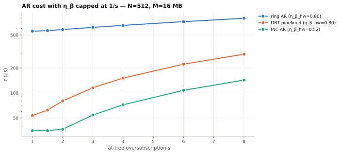
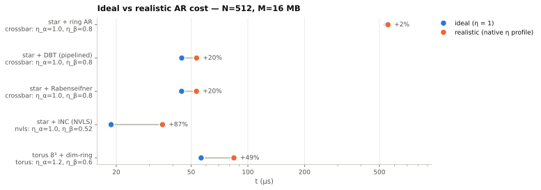
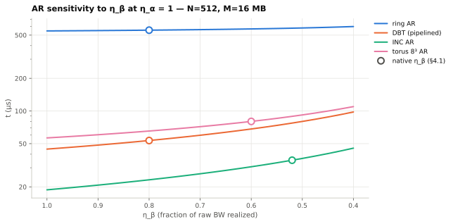

# Contention and Congestion: From Algorithmic Ceilings to Realized Performance

**Author:** Yue Lu  
**Date:** April 2026  

`02_topology_mapping.md` scored each collective as if it ran alone on a perfectly-scheduled fabric; `04_in_network_collectives.md §1.4` tightened that upper bound to the algorithmic ceiling ($n_\alpha, \mathrm{BW_{eff}}$) under in-network reduction. Real deployments fall below both — some of the gap is baked into the silicon and fabric (link utilization ceilings, switch queueing, cross-tier backpressure), and some is left on the table by the runtime scheduler (which rank layout the allocator produces, which concurrent groups share physical links, how expert traffic is routed). This note splits the gap along that axis, introduces per-fabric contention coefficients $\eta_\alpha \ge 1$ and $\eta_\beta \in (0, 1]$ as the scalar aggregate, and re-runs the $N = 512$ comparison under realistic $\eta$ to show how much the ideal-model margins compress.

# Table of Contents

1. [From ceilings to realized](#1-from-ceilings-to-realized)
   - 1.1 [Bottleneck analysis](#11-bottleneck-analysis)
2. [Hardware-level inefficiencies](#2-hardware-level-inefficiencies)
   - 2.1 [Link BW utilization ceiling](#21-link-bw-utilization-ceiling)
   - 2.2 [Switch/fabric congestion under load](#22-switchfabric-congestion-under-load)
3. [Software/scheduling-level inefficiencies](#3-softwarescheduling-level-inefficiencies)
   - 3.1 [Off-prefix group layouts](#31-off-prefix-group-layouts)
   - 3.2 [Concurrent collective groups](#32-concurrent-collective-groups)
   - 3.3 [Skewed MoE routing](#33-skewed-moe-routing)
4. [Contention coefficients $\eta_\alpha$ and $\eta_\beta$](#4-contention-coefficients-eta_alpha-and-eta_beta)
   - 4.1 [Calibration from public benchmarks](#41-calibration-from-public-benchmarks)
   - 4.2 [Per-tier $\eta$ on hierarchical fabrics](#42-per-tier-eta-on-hierarchical-fabrics)
5. [Re-running $N = 512$ under realistic $\eta$](#5-re-running-n--512-under-realistic-eta)
   - 5.1 [Ideal vs realistic AR cost](#51-ideal-vs-realistic-ar-cost)
   - 5.2 [What changed](#52-what-changed)
   - 5.3 [Margin compression](#53-margin-compression)
   - 5.4 [AG / RS and A2A under realistic $\eta$](#54-ag--rs-and-a2a-under-realistic-eta)
6. [What the coefficient model doesn't capture](#6-what-the-coefficient-model-doesnt-capture)
   - 6.1 [Layout-dependent contention](#61-layout-dependent-contention)
   - 6.2 [Payload-size-dependent contention](#62-payload-size-dependent-contention)
   - 6.3 [Dynamic patterns](#63-dynamic-patterns)
   - 6.4 [Cross-tier propagation in multi-tier fabrics](#64-cross-tier-propagation-in-multi-tier-fabrics)
7. [When $\eta$ is load-bearing](#7-when-eta-is-load-bearing)
8. [Further reading](#further-reading)

---

## 1. From ceilings to realized

The cost formulas in `02_topology_mapping.md` and the INC ceilings in `04_in_network_collectives.md §1.4` both describe upper bounds. Realized deployment performance sits below those ceilings, and the gap decomposes cleanly into two sources:

- **Hardware-level inefficiencies** — what an isolated, perfectly-scheduled collective still pays because the fabric cannot sustain its nominal link BW or switch latency under realistic load (§2).
- **Software/scheduling-level inefficiencies** — what the runtime scheduler leaves on the table by accepting an off-prefix rank layout, scheduling concurrent groups that share physical links, or routing expert traffic non-uniformly (§3).

A useful way to keep the two separated: if the inefficiency persists when a single, isolated collective runs on a freshly-booted cluster, it's hardware-level. If it disappears when the scheduler makes better choices without touching the silicon, it's software/scheduling-level.

**Scope assumption.** We assume the deployment has already selected the right algorithm for its fabric at design time (DBT or NVLS on star, dim-decomp on torus, INC where available). Algorithm pairing is a one-time design decision, not a runtime contention effect; a well-designed deployment pays it only in the form of "pick the right one," after which the $(\eta_\alpha, \eta_\beta)$ model below prices what's left.

Both sources show up in the cost model as a combination of "more $\alpha$" and "less effective BW." §4 introduces the scalar $(\eta_\alpha, \eta_\beta)$ coefficients that aggregate them per (fabric, collective).

### 1.1 Bottleneck analysis

The cost formulas in `02_topology_mapping.md` and the realistic discounts in this note are both computed via the same technique: **bottleneck analysis**. Identify the link (or group of links) carrying the most bytes during a collective operation, and compute the time to drain it as

$$t_{\mathrm{BW}} \\;=\\; \frac{\text{bytes through the bottleneck}}{\text{bottleneck throughput}}$$

This works because the operation isn't complete until every byte has reached its destination — the most-loaded link is the last to finish, and every other (lighter-loaded) link has already completed by the time it's done. The bottleneck's load and throughput therefore set wall-clock BW time; any scheduling trick that doesn't reduce the bottleneck's load doesn't reduce this time. See `02_topology_mapping.md §3.6` for the concrete derivation on torus A2A.

**Ideal regime.** Under symmetric assumptions (uniform routing, isolated groups, no hotspot traffic, no hardware saturation), the bottleneck is identified cleanly by fabric geometry — the bisection cut for torus A2A (`02_topology_mapping.md §3.6`), the upper-tier uplink under oversubscription ratio $s$ for fat-tree (`03_hierarchical_topologies.md §1`), the per-dim ring's single link for dim-decomposed AR (`02_topology_mapping.md §3.4`). Per-link loads are either uniform by graph symmetry or set by tight structural arguments, so the bottleneck bound matches measured performance closely. This is the starting point that `02_topology_mapping.md`'s cost formulas describe.

**Realistic regime — three ways contention breaks the ideal.** Contention doesn't invalidate the framework; it shifts the inputs:

1. **The bottleneck location can change.** Concurrent collective groups sharing a dim, off-prefix layouts scattering chunks across multiple dim-lines, hotspot MoE destinations concentrated on one axis — each of these moves "which link is worst-loaded" away from the ideal-model location.
2. **Per-link load variance widens.** Uniform routing symmetry no longer holds; under skewed MoE routing some links carry 3–10× more traffic than others, under oversubscription upper-tier links carry $s$× more than lower-tier ones. The bottleneck is strictly worse than the average, so "average load × BW" style reasoning underestimates realized time.
3. **The bottleneck's own throughput degrades.** Switch queueing, head-of-line blocking at congested ports, and flow-control backpressure reduce the bottleneck link's effective BW below its nominal per-link value. The BW we divide by shrinks.

**Mapping to $(\eta_\alpha, \eta_\beta)$.** The coefficient model introduced in §4 aggregates these three effects into two scalars per (fabric, collective): $\eta_\beta \in (0, 1]$ discounts the BW term to account for (2) and (3) above, $\eta_\alpha \geq 1$ inflates the α term to account for queueing hops. §2 (hardware-level) and §3 (scheduling-level) catalog which specific mechanisms drive each shift.

---

## 2. Hardware-level inefficiencies

These are unavoidable without different silicon or different fabric architecture. Each shows up in the coefficient model as a floor on $\eta_\beta$ or a floor on $\eta_\alpha$ that the software stack cannot drive away.

### 2.1 Link BW utilization ceiling

Nominal per-link bandwidth is set by pin count $\times$ signaling rate, but the fraction a collective actually sees is discounted by framing overheads, endpoint DMA efficiency, and flow-control headroom required to keep the link from stalling. A user report on the NCCL-tests tracker puts the practical AR busbw of 8-GPU NVLink4 servers (H20 / H100 / H200) around $360\\,\mathrm{GB/s}$ against $450\\,\mathrm{GB/s}$ raw unidirectional link BW [H100-SPEC], [NCCL-NVLS-REPORTS] — a baseline $\eta_\beta \approx 0.80$ that shows up *without any concurrency at all*. This is the floor the software stack cannot beat: even a single TP AR on an otherwise-idle node pays it.

### 2.2 Switch/fabric congestion under load

Wormhole / cut-through routing keeps per-message BW close to peak once a path is established. Queue delay, not per-hop latency, is what inflates under load: as fabric utilization crosses $\sim 80\\%$, head-of-line blocking and arbitration delay at each switch grow super-linearly. Effective $\alpha$ per message can double or triple when the fabric carries multiple concurrent traffic classes — training mixes gradient AR with activation AG/RS and DP AR; inference mixes TP AR with KV streaming and scheduler messages; HPC mixes MPI collectives with RDMA p2p. The α-β model doesn't price this implicitly, so congestion shows up as $\eta_\alpha > 1$.

**Hierarchical specialization.** Multi-tier Clos and fat-tree fabrics typically oversubscribe upper tiers relative to leaves (e.g., 2:1 or 4:1 at the aggregation layer). When an upper-tier link saturates, credit-based flow control pushes backpressure into lower tiers — the same congestion mechanism, but per-tier $\eta$ treats tiers as independent and under-counts the coupling. Tight flow-controlled fabrics (InfiniBand, RoCE with PFC) violate the independence assumption; loose store-and-forward or timeout-based fabrics approximate it better. For scale-out INC paths (`04_in_network_collectives.md §2.2`), cross-tier coupling is what makes the $2k\alpha_\mathrm{switch}$ floor grow faster than the per-tier walk under saturation.

---

## 3. Software/scheduling-level inefficiencies

These are fixable in the scheduler — different rank layout, different group placement, different routing policy — without touching the hardware. They show up as an *additional* discount on top of the hardware floor: if the scheduler picks well, realized $\eta$ approaches the hardware-only floor; if it picks badly, realized $\eta$ can be much worse.

### 3.1 Off-prefix group layouts

Torus dim-decomp AR hits $n_\alpha = 2 \sum (d_i - 1)$ only when the collective group's ranks are contiguous along dim prefixes. A group of 16 ranks on an $8 \times 8 \times 8$ torus where the ranks are $\\{(0,0,0), (1,0,0), \ldots, (7,0,0), (0,1,0), \ldots\\}$ is prefix-contiguous along dim-0 — the algorithm runs as an 8-ring along dim-0 followed by a 2-ring along dim-1.

But SLURM-style scatter allocation, or a job that inherits a random-looking rank layout, produces groups where ranks are spread across dim coordinates. Each algorithmic hop becomes a multi-hop path in the physical topology. The formula degrades back to the flat-ring bound ($n_\alpha \approx 2(N-1)$), often 2-4× the ideal. This is a **scheduler choice**, not a hardware limit: prefix-aligned allocation policies exist, and when available they eliminate this penalty entirely.

**Residual unavoidable case.** Two cases escape even an optimal allocator: (a) **group-shape mismatch** — a TP = 6 group on an $8 \times 8 \times 8$ torus has no prefix-contiguous placement because 6 doesn't divide any dim; (b) **multi-tenant fragmentation** — a shared cluster with asynchronous job arrivals eventually runs out of prefix-aligned free slots and must place the next job off-prefix. Both are set by workload shape × topology geometry, not by the scheduler.

### 3.2 Concurrent collective groups

If the cluster runs DP = 8 replicas each doing TP = 8 AR simultaneously, where those 8 groups land on the physical fabric matters. On a **star** with $N = 64$ ports, the 8 groups partition into 8 disjoint port octets — each sees full BW with zero interference. **Torus is different**: two groups interfere only when their rings traverse the same physical links. Eight TP = 8 groups that each occupy a *whole* dim-line (8 of the 64 X-rings of an $8 \times 8 \times 8$ torus) are link-disjoint and each sees full BW. But groups that share a dim-line — two TP = 4 groups on one 8-ring, or groups whose off-prefix placement routes through each other's ranks — put their traffic on the same links, and the per-link BW is split. The ideal dim-decomp AR formula assumes each group's rings are link-disjoint from every other group's; concurrent-group layouts can violate that assumption.

Like off-prefix layouts, this is a **layout choice** made by the job scheduler. A layout-aware scheduler that gives each concurrent group its own dim-lines avoids the penalty; a naive scheduler pays it.

**Residual unavoidable case.** Sharing is forced when: (a) **a group does not fill its dim-line** — a TP = 4 group on an 8-ring has no private wraparound, so it either runs as an open line (the $k$-D mesh cost of `02_topology_mapping.md §4.2`) or closes its ring through the links of the group next to it; (b) **traffic transits other groups' blocks** — collectives whose members are not adjacent (A2A across the pod, PP hand-offs between distant stages, any off-prefix group) forward through links inside blocks owned by other groups, loading them however well those groups were placed. Once forced, the per-link BW splits across the groups sharing it.

### 3.3 Skewed MoE routing

The uniform-bisection A2A bound assumes all $(i, j)$ pairs carry equal traffic. Real MoE traces show 3-10× skew between hot and cold experts — a handful of experts receive the bulk of routed tokens. The bisection cut still carries $N M / 2$ bytes *on average*, but tail latency is set by the hottest link, not the average. Torus has hotspots under skewed routing: hot-expert destinations concentrated along one dim saturate that dim's bisection well before the uniform bound predicts. Star absorbs skew uniformly because every port has the same BW.

Skew is a policy-level artifact of the routing function (top-$k$ gating, capacity factor, expert placement). Load-balancing losses, expert shuffling, and capacity-factor tuning all discount the skew penalty without hardware changes.

**Residual unavoidable case.** Routing is **input-dependent**: even with perfectly load-balanced long-run averages, a single batch can be skewed by what tokens it happens to contain. Average-case throughput can be driven close to uniform, but per-step tail latency always sees some residual hotspot — which is what latency-SLA workloads actually pay on.

---

## 4. Contention coefficients $\eta_\alpha$ and $\eta_\beta$

The idealized collective cost is $t = n_\alpha \cdot \alpha + n_\beta \cdot (M / \mathrm{BW})$. Under the combined discount from §2 and §3, replace with

$$t_{\mathrm{effective}} = n_\alpha \cdot \alpha \cdot \eta_\alpha + n_\beta \cdot \frac{M}{\mathrm{BW} \cdot \eta_\beta}$$

Interpretation:

- $\eta_\alpha \ge 1$ **inflates** the latency term. Aggregates arbitration delay, head-of-line blocking, and cross-tier backpressure under congestion (§2.2), plus any layout-driven extra hops (§3.1).
- $\eta_\beta \in (0, 1]$ **deflates** the effective bandwidth. Aggregates the hardware BW ceiling (§2.1), link sharing between concurrent groups (§3.2), and bisection saturation from skewed traffic (§3.3).

Both default to 1.0, which recovers the ideal model. The cleanest way to apply them is **at the fabric-tier level** — each switch tier or link class carries its own $(\eta_\alpha, \eta_\beta)$, and the primitive cost function sees an "effective" tier with already-discounted $\alpha$ and $\mathrm{BW}$ values. No algorithm-level plumbing is required. The two scalars are deliberately coarse — they capture only the first-order "how much worse than the isolated-primitive upper bound"; §6 catalogs what scalar coefficients can't express, and §7 covers when to escalate to packet-level simulation.

### 4.1 Calibration from public benchmarks

A representative $\eta$ profile calibrated from publicly reported measurements:

| Fabric | $\eta_\alpha$ | $\eta_\beta$ | Source |
|---|---|---|---|
| Crossbar (NVLink+NVSwitch, no SHARP) | 1.00 | 0.80 | Community-reported NCCL-tests AR busbw ≈ 360 GB/s vs 450 GB/s peak on 8-GPU NVLink4 servers → 0.80 [NCCL-NVLS-REPORTS] |
| NVLS (NVLink SHARP, in-network reduction) | 1.00 | 0.52 | Community-reported NVLS busbw ≈ 470 GB/s vs ≈ 360 GB/s without NVLS ($\sim 1.3\times$ lift) on the same class of hardware [NCCL-NVLS-REPORTS]; back-solves to $\eta_\beta^{\mathrm{INC}} \approx 1.3 \cdot \eta_\beta^{\mathrm{DBT}} / 2 = 0.52$ under the $n_\beta^{\mathrm{INC}} = 1$ framing |
| Torus (off-prefix + concurrent groups) | 1.20 | 0.60 | TPU v4 twisted-vs-untwisted 1.63× A2A reported gap [TPU-V4], interpreted as upper-bound $\eta_\beta \approx 1/1.63 \approx 0.6$ under adversarial layouts |

**Why $\eta_\beta^{\mathrm{INC}} < \eta_\beta^{\mathrm{DBT}}$ even though INC wins.** $\eta_\beta$ is measured against *raw* link BW, and the algorithmic factor sits in $n_\beta$. DBT's $n_\beta = 2$ already bakes in a 2× slack, so its $\eta_\beta = 0.80$ applies to a target that was never the full link. INC's $n_\beta = 1$ attempts the full link, and switch-ALU throughput plus multicast contention keep it from fully realizing that — so its $\eta_\beta$ looks lower, even though its *realized* per-rank BW ($0.52 \cdot \mathrm{BW}$) still beats DBT's ($0.80 \cdot \mathrm{BW} / 2 = 0.40 \cdot \mathrm{BW}$) by $\sim 1.3\times$.

**Provenance.** The two NVLink rows rest on user-reported NCCL-tests runs in NVIDIA's public issue trackers, not on vendor-published benchmarks: an 8-GPU run with NVLS enabled reports AR busbw of 470–482 GB/s for 1–8 GB messages; its reporter does not name the GPU model and states — without measuring it in that run — a typical practical maximum near 360 GB/s against a 450 GB/s theoretical figure for H20 / H100 / H200. A separate 8×H100 report sees bus bandwidth go from about 330 to about 430 GB/s when NVLS is switched on, on one or two nodes only — the same $1.3\times$ ratio [NCCL-NVLS-REPORTS]. NVIDIA's NCCL-tests documentation defines busbw but publishes no reference numbers [NCCL-TESTS]. Treat 0.80 and 0.52 as indicative. Both values also read the reports with a busbw factor of exactly 2 (a software all-reduce moving $2M$ per rank). NCCL-tests normalizes all-reduce busbw by $2(N-1)/N$, which is 1.75 at the 8-GPU size of these reports, so under the exact normalization both move together: $360/450 = 0.80$ is exact only for a schedule with $n_\beta = 2(N-1)/N$ (ring); for the $n_\beta = 2$ DBT form it becomes $2 \cdot 360 / (1.75 \cdot 450) \approx 0.91$, and the INC value becomes $470 / (1.75 \cdot 450) \approx 0.60$. Either pair — $(0.80,\, 0.52)$ with the factor 2 on both, or $(0.91,\, 0.60)$ with 1.75 on both — reproduces the $1.3\times$ lift; the series keeps the factor-2 pair, the more conservative of the two.

**These are worst-case-realistic, not typical.** A well-tuned deployment with prefix-aligned groups (§3.1) and link-disjoint concurrent groups (§3.2) will see smaller torus $\eta$ penalties — the profile is a lower bound on performance, not an expectation.

**Calibrating proprietary or newer fabrics.** Run NCCL-tests (or an equivalent collective benchmark) under the intended concurrent-group pattern and back out $\eta$ from the ratio of measured `busbw` to the raw per-direction link BW (the theoretical peak of `busbw` for a schedule whose $n_\beta$ equals the benchmark's busbw factor $C(N)$). In general $\eta_\beta = \mathrm{busbw} \cdot n_\beta / (C(N) \cdot \mathrm{BW})$ (`01_collective_algorithms.md` Appendix D) — the general form matters for in-network AR ($n_\beta = 1$), whose `busbw` can exceed the link rate.

### 4.2 Per-tier $\eta$ on hierarchical fabrics

The flat-scalar profile above (one $(\eta_\alpha, \eta_\beta)$ pair per fabric) is appropriate for single-tier topologies — star, torus within one pod, full mesh — where all traffic sees the same link class. Hierarchical fabrics (fat-tree, Clos, and the layered compositions in `03_hierarchical_topologies.md`) require a **per-tier $\eta$ pair** because each tier has distinct saturation behavior. Leaf-level links rarely saturate because per-endpoint BW is sized to match endpoint ingress; upper tiers (spine, super-spine) saturate first under cross-leaf fan-in, and their saturation is gated by the oversubscription ratio.

**Oversubscription upper-bounds upper-tier $\eta_\beta$.** A tier oversubscribed at ratio $s \geq 1$ (`03_hierarchical_topologies.md §1`) has aggregate upper-tier BW equal to $1/s$ of the aggregate downlink demand. Under uniform cross-tier traffic, every byte climbing the tier competes for that $1/s$-fraction of capacity, so the **realized $\eta_\beta$ at that tier is capped**:

$$\eta_\beta^{\mathrm{upper\text{-}tier}} \\;\leq\\; \min\\!\left(\eta_\beta^{\mathrm{hw\\,floor}}, \\; \frac{1}{s}\right)$$

The inequality binds at $1/s$ whenever $s$ drives the cap below the tier's hardware floor (e.g., $s = 2$ at a tier whose hardware floor would otherwise be $0.80$ caps realized $\eta_\beta$ at $0.50$). Below $1/s$ the actual value is further discounted by ECMP (Equal-Cost Multi-Path) hash collisions, queue-buildup arbitration, and tier-coupling backpressure. ECMP load-balances each flow across one of several equal-cost upper-tier paths by hashing the packet's 5-tuple (src/dst IP, src/dst port, protocol) — deterministic per flow (so packets within a flow stay in order), but when distinct flows hash to the same path they pile onto it and leave other equivalent paths idle. The $\alpha$ side gets its own inflation factor $\eta_\alpha > 1$ from cross-tier queueing under load (§2.2), not from oversubscription directly — oversubscription is a BW lever.

**Per-tier $\eta$ profile for a 2-tier leaf-spine fabric.** At representative oversubscription ratios:

| Tier | Role | $\eta_\alpha$ | $\eta_\beta$ at $s = 1$ | $\eta_\beta$ at $s = 2$ | $\eta_\beta$ at $s = 4$ |
|---|---|---|---|---|---|
| Leaf (endpoint ↔ leaf switch) | Intra-leaf traffic only | 1.00 | 0.80 | 0.80 | 0.80 |
| Spine (leaf ↔ spine) | Cross-leaf traffic | 1.10–1.30 | 0.80 | 0.50 | 0.25 |
| **Aggregate cross-leaf** |  | $\eta_\alpha^{\mathrm{spine}}$ | $\min(0.80, 1) = 0.80$ | $\min(0.80, 0.50) = 0.50$ | $\min(0.80, 0.25) = 0.25$ |

The leaf row matches the single-tier NVSwitch-class floor (§4.1's crossbar row) because per-endpoint BW is not oversubscribed. The spine row's $\eta_\beta$ is $\min(0.80, 1/s)$ — oversubscription dominates the hardware floor once $s > 1.25$. $\eta_\alpha^{\mathrm{spine}} = 1.10\text{–}1.30$ reflects cross-tier queueing at moderate load on credit-based flow control (InfiniBand) or PFC-configured Ethernet; the factor climbs to 2–3× as fabric utilization crosses 80%.

*Figure: the cap in action — the $N = 512$, $M = 16\\,\mathrm{MB}$ AR re-priced with $\eta_\beta = \min(\eta_\beta^{\mathrm{hw\\,floor}}, 1/s)$ applied to the whole collective (an illustration, not a tiered model). INC's lower hardware $\eta_\beta$ (0.52) is the binding term until $s \approx 2$; at $s = 4$ INC costs 72 μs and DBT 151 μs. From `code/notebooks/03_eta_sensitivity.ipynb`.*

**3-tier Clos.** A super-spine tier extends the table with a third row. If the super-spine is oversubscribed at $s_3$ independently of the spine-tier $s_2$, cross-pod BW compounds: $\eta_\beta^{\mathrm{cross\text{-}pod}} \leq 1/(s_2 \cdot s_3)$ when traffic crosses both tiers (the two ratios multiply). Most production Clos fabrics oversubscribe only one tier (typically the super-spine at $s_3 \in \\{2, 4\\}$), keeping the leaf-spine tier at $s_2 = 1$ — which pins $\eta_\beta^{\mathrm{cross\text{-}pod}} \leq 1/s_3$.

**Applying per-tier $\eta$ in the AR cost formula.** For the two-tier RS → sub-AR → AG decomposition from `03_hierarchical_topologies.md §2.1`, each phase uses its own tier's coefficients:

$$t_{\mathrm{AR,realistic}} \\;=\\; \underbrace{t_{\mathrm{RS,inner}}\\!\left(\tfrac{N}{L},\\, M\right)}\_{\text{at } (\eta_\alpha^{\mathrm{inner}},\\, \eta_\beta^{\mathrm{inner}})} \\;+\\; \underbrace{t_{\mathrm{AR,outer}}\\!\left(L,\\, \tfrac{ML}{N}\right)}\_{\text{at } (\eta_\alpha^{\mathrm{outer}},\\, \eta_\beta^{\mathrm{outer}})} \\;+\\; \underbrace{t_{\mathrm{AG,inner}}\\!\left(\tfrac{N}{L},\\, M\right)}\_{\text{at } (\eta_\alpha^{\mathrm{inner}},\\, \eta_\beta^{\mathrm{inner}})}$$

The `inner`/`outer` naming follows `03_hierarchical_topologies.md §1.2`. In a flat leaf-spine Clos (single GPUs attached directly to leaves), `inner` is intra-leaf (η table's leaf row) and `outer` is cross-leaf (aggregate cross-leaf row, capped by $\min(\eta_\beta^{\mathrm{hw}},\\, 1/s)$). In a NVL72 + IB SuperPOD, `inner` is the intra-pod NVLink fabric and `outer` is the IB Clos itself, with the leaf/spine sub-tiers feeding into $\eta^{\mathrm{outer}}$.

SHARP at the spine tier of the outer Clos (`04_in_network_collectives.md §2.2`) replaces the middle term with an INC AR at $n_\alpha = 2k$ switch hops. The spine-row $\eta_\beta$ still applies because oversubscription limits the BW the switch ALU can forward between tiers — SHARP sidesteps the $\alpha$-side contention but not the tier-BW cap from $s$.

---

## 5. Re-running $N = 512$ under realistic $\eta$

Using the realistic profile from §4.1, re-run the AR ladder from `04_in_network_collectives.md §3.1` at $N = 512$, $M = 16\\,\mathrm{MB}$, $\alpha = 0.5\\,\mu$s, $\mathrm{BW} = 900\\,\mathrm{GB/s}$. We score the optimized pairings on each fabric — DBT on star, dim-decomp on torus, NVLS-style INC on the hypothetical single-switch star from `04_in_network_collectives.md §3` — per the scope assumption in §1.

### 5.1 Ideal vs realistic AR cost

| Topology + algo | $n_\alpha$ | $n_\beta$ | Ideal $\alpha$ | Ideal BW | **Ideal total** | $\eta_\alpha$ | $\eta_\beta$ | Realistic $\alpha$ | Realistic BW | **Realistic total** |
|---|---|---|---|---|---|---|---|---|---|---|
| Hypothetical star + NVLS (INC) | 2 | 1 | 1 μs | 17.8 μs | **18.8 μs** | 1.00 | 0.52 | 1 μs | 34.2 μs | **35 μs** |
| Star + DBT (NCCL) | 18 | 2 | 9 μs | 35.6 μs | **45 μs** | 1.00 | 0.80 | 9 μs | 44.4 μs | **53 μs** |
| Torus $8^3$ + dim-ring | 42 | 2 | 21 μs | 35.5 μs | **56.5 μs** | 1.20 | 0.60 | 25.2 μs | 59.1 μs | **84 μs** |

*Figure: ideal versus realistic AR cost for each pairing under its native $\eta$ profile ($N = 512$, $M = 16\\,\mathrm{MB}$): the table's three rows, plus ring and Rabenseifner on the crossbar profile for reference. For ring the two points nearly coincide (+2%). From `code/notebooks/03_eta_sensitivity.ipynb`.*

### 5.2 What changed

- **Star + INC loses $\sim 16\\,\mu$s** (87% increase — the largest *relative* penalty of the three). Its ideal BW term is already at the raw-link ceiling ($M / \mathrm{BW}$), so the $\eta_\beta = 0.52$ realization loss nearly doubles the wall-clock cost. Despite this, INC is still the fastest at 35 μs — ~1.5× ahead of star+DBT and ~2.4× ahead of torus.
- **Star + DBT loses $\sim 9\\,\mu$s** (20% increase). The BW-dominated cost is inflated by $\eta_\beta = 0.80$; $\alpha$ is unaffected.
- **Torus loses $\sim 28\\,\mu$s** (49% increase). Both $\eta_\alpha$ and $\eta_\beta$ hit it. The BW term goes from 35.5 μs — level with star — to 59.1 μs: 67% above its own ideal, and a third above star + DBT's realistic 44.4 μs. The $\alpha$ term inflates 20%.

### 5.3 Margin compression

| | Ideal | Realistic | Gap to INC (ideal → realistic) |
|---|---|---|---|
| Star + INC | 18.8 μs | 35 μs | — |
| Star + DBT | 45 μs | 53 μs | $2.4\times$ → $1.5\times$ |
| Torus dim-decomp | 56.5 μs | 84 μs | $3.0\times$ → $2.4\times$ |

**Takeaway:** the ideal-model ranking is preserved — INC < DBT < torus — but the margins compress *toward* INC as realistic contention kicks in. This is the mirror image of the naive expectation. INC's ideal ceiling is the highest above its realistic cost (87% inflation) because its BW term is closest to the raw-link limit and has nowhere left to hide; DBT and torus start further from their limits and absorb contention into already-padded BW terms. The gap between INC and the next-best software collective compresses from $2.4\times$ to $1.5\times$, and the gap to torus from $3.0\times$ to $2.4\times$ — INC is still the winner, but the ceiling-vs-realized story flagged in `04_in_network_collectives.md §4` (limit 6) is where most of the "2× ceiling vs ~1.3× reported" NVLS lift goes.

The star-vs-torus margin moves the other way — it widens: star+DBT vs torus goes from 45 vs 56.5 μs (~27% gap) ideal to 53 vs 84 μs (~58% gap) realistic, because torus pays $\eta$ at both $\alpha$ and BW while star+DBT only pays it on BW. The "star vs torus" decision under realistic $\eta$ is more contention-sensitive than the ideal numbers suggest.

### 5.4 AG / RS and A2A under realistic $\eta$

§5.1–§5.3 covered AR. Re-running the AG / RS and A2A ladders from `04_in_network_collectives.md §3.3` at the same anchor ($N = 512$, $M = 16\\,\mathrm{MB}$, $\alpha = 0.5\\,\mu$s, $\mathrm{BW} = 900\\,\mathrm{GB/s}$) uses a different $\eta_\beta$ for the INC row than AR did: INC AG uses only the multicast path (no switch ALU), so it inherits the crossbar-multicast baseline $\eta_\beta = 0.80$ rather than NVLS's 0.52. INC RS does pass through the switch ALU, and there is no separate public calibration for it; the table applies the same 0.80 to both as the optimistic case (at NVLS's 0.52 the RS row's realistic BW term would be 34.1 μs and its total 35.1 μs — behind star + RHD's 26.7 μs, so INC RS's lead in the table below rests on this assumption). This is the coefficient-level reflection of the "no BW ceiling lift" structural point from `04_in_network_collectives.md §1.4`: INC AG / RS runs at the same realized BW as a well-scheduled software AG / RS on a full-duplex crossbar.

**AG / RS.**

| Topology + algo | Ideal $\alpha$ | Ideal BW | **Ideal total** | $\eta_\alpha$ | $\eta_\beta$ | Realistic $\alpha$ | Realistic BW | **Realistic total** |
|---|---|---|---|---|---|---|---|---|
| Hypothetical star + INC | 1.0 μs | 17.7 μs | **18.7 μs** | 1.00 | 0.80 | 1.0 μs | 22.2 μs | **23.2 μs** |
| Star + RHD | 4.5 μs | 17.7 μs | **22.2 μs** | 1.00 | 0.80 | 4.5 μs | 22.2 μs | **26.7 μs** |
| Torus $8^3$ + dim-decomp | 10.5 μs | 17.7 μs | **28.2 μs** | 1.20 | 0.60 | 12.6 μs | 29.6 μs | **42.2 μs** |

**A2A.**

| Topology + algo | Ideal $\alpha$ | Ideal BW | **Ideal total** | $\eta_\alpha$ | $\eta_\beta$ | Realistic $\alpha$ | Realistic BW | **Realistic total** |
|---|---|---|---|---|---|---|---|---|
| Star + pairwise (NCCL) | 255.5 μs | 17.7 μs | **273 μs** | 1.00 | 0.80 | 255.5 μs | 22.2 μs | **278 μs** |
| Hypothetical star + INC | — | — | — | — | — | — | — | **N/A on shipping NVSwitch / Quantum-X800** (HW A2A: `04_in_network_collectives.md §1.3`) |
| Torus $8^3$ + bisection (TPU / Trainium) | 6.0 μs | 17.8 μs | **23.8 μs** | 1.20 | 0.60 | 7.2 μs | 29.6 μs | **36.8 μs** |

Three observations:

- **AG / RS margins are already tight and stay tight.** Star INC (23.2 μs) vs star RHD (26.7 μs) vs torus (42.2 μs). The ideal $1.2\times$ INC-vs-RHD gap compresses slightly to $1.15\times$ under realistic $\eta$ — $\alpha$ savings are preserved (INC still wins on $n_\alpha$), but both rows hit the same BW floor so contention doesn't open the gap. At this $M$ the AG / RS cost is BW-dominated, but the BW term is common to every contender, so the whole INC-vs-software fight happens on the $\alpha$ side.
- **A2A ranking still favors the torus under any realistic scoring.** Ideal: torus 23.8 μs < pairwise 273 μs. Realistic: torus 36.8 μs < pairwise 278 μs — ordering preserved, but torus's $\sim 11.5\times$ ideal advantage over the shipped NCCL pairwise compresses to $\sim 7.5\times$ under $\eta$ because pairwise's $\alpha$-dominated cost absorbs contention only on the tiny BW term while torus pays $\eta$ on both. With no documented HW-A2A path on shipping hardware (`04_in_network_collectives.md` §1.3), the $8^3$ torus is the only option here that avoids the $(N-1)\\,\alpha$ serial-send term (its $d_{\max}/8$ bisection coefficient is $1\times$ at this shape) — the gap a hardware A2A primitive would close.
- **Realistic-$\eta$ collapses the cross-primitive ordering into a simple rule.** AR wins by ~$1.5\times$ on INC-capable star; AG / RS wins by ~$1.2\times$ on INC (for RS, only under the optimistic $\eta_\beta = 0.80$ assumption above); A2A wins by ~$7.5\times$ on the $8^3$ torus (no INC help on shipping NVSwitch / Quantum-X800 HW). The realistic $\eta$ profile doesn't reshuffle the winner within each primitive, but it moves the margins unevenly: INC's lead over software-on-star compresses, software-on-star's lead over torus widens (INC-vs-torus compresses for AR and widens for AG / RS), and torus's A2A lead compresses — which directly feeds the topology-choice Pareto sweep of `03_hierarchical_topologies.md §3.3` and §7 below.

---

## 6. What the coefficient model doesn't capture

Scalar $(\eta_\alpha, \eta_\beta)$ per (fabric, collective) is a back-of-envelope model. It cannot express:

### 6.1 Layout-dependent contention

Two TP groups whose ranks are all in dim-0 conflict. Two TP groups whose ranks are orthogonal (one in dim-0, one in dim-2) don't. A single $\eta_\beta$ averages over layout. A layout-aware model would need to take the rank-to-coordinate map as input and compute link-sharing per pair of groups.

### 6.2 Payload-size-dependent contention

Contention often manifests at small messages (queue delay dominates) and vanishes at large messages (BW utilization is steady). The coefficient is a workload-average — it over-predicts penalty for large-$M$ collectives (prefill, bulk gradient AR) and under-predicts for small-$M$ collectives (decode AR, latency-critical HPC reductions).

### 6.3 Dynamic patterns

Expert skew, traffic bursts, and temporal collisions between collective steps are all dynamic. A coefficient matched to average load under-reports tail latency, which is often what the user cares about (latency SLA > average throughput).

### 6.4 Cross-tier propagation in multi-tier fabrics

In hierarchical fabrics (multi-tier Clos, fat-tree, or any switched fabric where upper tiers are oversubscribed relative to lower tiers), saturation at an upper tier can push backpressure into lower tiers via credit-based flow control — but a per-tier $\eta$ treats tiers as independent. Tight flow-controlled fabrics violate this assumption; loose store-and-forward or timeout-based fabrics approximate it better.

For any of these, the right answer is a higher-fidelity simulator (packet-level or event-driven, e.g. SST, Booksim). The coefficient model is the layer between "zero contention" and "simulate it" — cheap enough to use in a topology-choice Pareto sweep, principled enough that the rankings mean something.

---

## 7. When $\eta$ is load-bearing

The $(\eta_\alpha, \eta_\beta)$ defaults in §4.1 are calibrated from public measurements but still broadly applicable. They're good enough for three classes of decision:

- **First-pass topology selection.** "Star vs torus for a new 512-GPU cluster" — the ideal-$\eta$ ranking often holds, but realistic-$\eta$ shifts the margins. Both sweeps should agree on the top choice; if they don't, the decision is contention-sensitive and warrants simulation.
- **Scheduler-policy review.** "Are our rank-allocation and concurrent-group policies prefix-aligned on torus?" — off-prefix (§3.1) and concurrent-group (§3.2) penalties are the primary reason realistic torus $\eta_\beta$ sits at 0.60 vs the 0.80 a star pays; a policy change can recover much of that.
- **Sensitivity analysis.** "How much does our end-to-end step time depend on contention?" (TPOT for inference, step-time for training) — sweep $\eta$ from (1.0, 1.0) ideal to (1.5, 0.4) aggressive and report the envelope.

*Figure: the sensitivity sweep on $\eta_\beta$ alone ($N = 512$, $M = 16\\,\mathrm{MB}$). Hollow circles mark each algorithm's native $\eta_\beta$ from §4.1; $\eta_\alpha$ is held at 1, so the torus point is 80 μs rather than §5.1's 84 μs. At equal $\eta_\beta$ the ranking INC < DBT < torus < ring holds across the whole range. From `code/notebooks/03_eta_sensitivity.ipynb`.*

Cases where $\eta$-based ranking is **not enough** and you should escalate to real simulation or measurement:

- **Deployment budgeting for a new fabric architecture.** "What's the actual max-throughput step time for configuration X?" (TPOT for inference, iteration time for training) — coefficient model will be off by factor-of-2 under unmodeled cross-tier dynamics; need hardware-trace calibration.
- **Production SLA guarantees.** Tail latency dominates; coefficients give average-case estimates.
- **Comparing fabrics within 20% of each other.** The error bars on $\eta$ defaults are wider than 20%; any "ideal-$\eta$ ranking changes under realistic-$\eta$" result should prompt a closer look, not a definitive call.

---

## Further reading

- **`04_in_network_collectives.md` §3.1** — the ideal-$\eta$ $N = 512$ AR ladder that this note re-runs under realistic $\eta$ in §5.
- **`04_in_network_collectives.md` §1** — SHARP / NVLS does the reduction in the switch itself, removing the per-step endpoint $\alpha$ that contention inflates; on the BW side the §4.1 calibration gives NVLS the lowest $\eta_\beta$ (0.52), because its $n_\beta = 1$ target is the full link.
- **`03_hierarchical_topologies.md` §3.2** — how the $\eta$ profile here generalizes when topologies compose across tiers: each tier carries its own $(\eta_\alpha, \eta_\beta)$, and the hierarchical cost rule propagates them per phase.
- **`02_topology_mapping.md` §5.2** — the four ways the ideal-$\eta$ model breaks (concurrent groups, off-prefix layouts, skewed A2A, mixed traffic), foreshadowed there and priced quantitatively in this note.
- **`references.md`** — the NCCL-tests methodology, the community NVLS reports and the TPU v4 paper behind the calibration.
